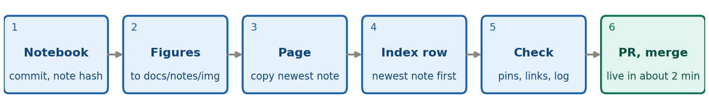

```{=latex}
\pagestyle{empty}\thispagestyle{empty}
\setlength{\parskip}{0.3em}
\setlength{\parindent}{0pt}
\renewcommand{\arraystretch}{1.05}
\vspace*{-1.2em}
\begin{center}
{\LARGE\bfseries\color{brand} Creating a note}\\[0.2em]
{\small Developer quick-sheet \textperiodcentered{} hand-written notes in \texttt{docs/notes/} \textperiodcentered{} version 8, 21 October 2026}
\end{center}
\vspace{0.2em}
```

**Two routes.** **Markdown, like a student note** (the simpler one, and what Note 9 used): copy `notes/src/_template.md` to `notes/src/your-note-name.md`, write it as [student guide 3](https://villano-lab.github.io/NSDF-Data/students/writing-a-note.html) says, keep `id: "TBD"`, check it with `python tools/check_note.py notes/src/your-note-name.md`{.cmd}, and open the PR. The page and the index row are built when you merge it, and you give it its number then (see the box at the bottom), so there is no NN to track: skip the steps below. **Hand-written HTML**, for a page the Markdown build cannot make: an HTML page in `docs/notes/` and one row in the front-page table, as follows. Start from `develop`, on a branch: `git switch -c feature/note-short-name`{.cmd}, with a name for the topic, for example `feature/note-psd-peaks`. **Leave the number out of the branch name and do not look it up yet** (the shared numbers are taken as notes are merged, so one found now may be gone by the time you finish). You pick **NN**, the note number, at step 6.

{width=100%}

```{=latex}
\small
```

1. **Notebook.** Do the analysis in `data_analysis/R76/notebooks/`, run it top to bottom, and commit it with any library change. Note the short hash: `git rev-parse --short HEAD`{.cmd}. Re-running some notebooks leaves metadata churn, so read `git diff`{.cmd} before committing. Never run `07221203_2025_dump1_noise.ipynb` without approval (it rewrites `data_analysis/archives/good_noise.h5`).
2. **Figures.** Save the PNGs from the executed notebook into `docs/notes/img/`, named for the series and the content, for example `dump1_bstd_time.png`.
3. **Page.** Copy the newest note, `note-02a-bstd-vs-time.html`, to `docs/notes/note-NN-slug.html`, writing the letters **NN** literally for now. Edit the `<title>`, the `<h1>` (write it as a question), the meta line (`Note NN · Author(s) · date · Status`; keep NN for now), and the `<nav class="outline">` with an `id` on every `<h2>`. Sections: Code Repository, Data and setup, The question, then the headings your story needs (one section per result with a `<figure>`, alt text and a caption; what it means and what could be wrong; next steps). Student guide 3 shows three notes with their headings.
4. **Pin the code.** Every link to a notebook or to `python/` uses the commit hash, never a branch name: under the repository URL, `blob/<hash>/<path>` for a file and `tree/<hash>/<folder>` for a folder. Check each one: `git cat-file -e <hash>:<path>`{.cmd} prints nothing when the file exists.
5. **Index row.** Add one `<tr>` to the Analysis Notes table in `docs/index.html`, **newest note first**. Columns: Note # (NN for now), Link, Date, Author, Title, Description, Keywords, Status. The status badge is `<span class="status in-progress">` (or `complete`, `superseded`, `abandoned`, `brainstorm`).
6. **Take the number.** Last, just before the PR: `git fetch`{.cmd} and `git merge origin/develop`{.cmd} to bring in any notes merged meanwhile, then `python tools/build_notes.py next`{.cmd}, which prints the next free number (student notes share the numbering; a follow-up takes a letter, like 2a). Replace **NN** with it in the file name, the meta line and the index row. If someone merges a note first, repeat this step: only the number changes.
7. **Changelog and checks.** Add a line under `[Unreleased]` in `CHANGELOG.md` (a new note is a patch-level change). Open the page from disk in a browser: figures show, links work. If you touched `python/`, run `cd python && python -m pytest -q`{.cmd}.
8. **PR.** `git push -u origin feature/note-short-name`{.cmd}, then `gh pr create --base develop --fill`{.cmd}. When the checks are green, merge: the page is live in about two minutes.

```{=latex}
\normalsize
```

**Updating a note** is the same loop, on a new branch from `develop`. Check its status first: a **Complete** note is left alone (a follow-up takes a letter, like 2a after 2), an **In progress** note can change freely, and a note that a later one replaces becomes **Superseded (reference/link)** with a link to the newer one. If you re-ran anything, re-pin the links to the new hash and replace the PNGs. Update the date and status in the page's meta line **and** in its row of `docs/index.html` (the row is hand-edited, so the two can drift). A wrong result stays in the note, corrected and dated; never delete a published note.

**Rules.** A **Complete** note gets only a minimal correction, and only when a library rename makes it wrong. A breaking library change means updating the notebooks that use it, or marking them deprecated (the red box described on the front page). Any whole-trace spectrum must skip the leading glitch samples. A *segment* is a run of same-trigger events; a *run* is a whole data-taking period.

::: tip
**Reviewing a student note.** The PR into `develop` shows a green check and nothing is public. Change `id: "TBD"` to the next note number: the *Student notes* check posts it on the PR as a suggestion on the `id` line, so press **Commit suggestion** (no checkout; `python tools/build_notes.py next`{.cmd} prints the same number, in the same numbering as the hand-written notes), and merge. With two note PRs open at once both are offered the same number: merge one, then re-run the check of the other to refresh its suggestion. The bot builds the page and its row in the Analysis Notes table, placed by number among the hand-written rows, and it is live in 2 to 3 minutes. When a student updates a published note, check the header still has its note number: `TBD` passes the PR check, but the build refuses it and nothing is published until you fix it. To remove a note, delete its source file in a PR; the next build removes the page.
:::
