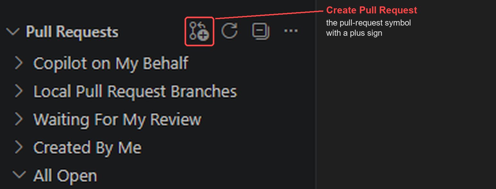

::: tip
**This is guide 9, and it is optional.** It does the same Git steps as the terminal guides, with buttons in VS Code instead of typed commands. If you are happy with the terminal, you do not need this guide. If a screen here does not match what you see, trust the terminal version, and tell your lead which step differed.
:::

## Before you start

- You finished the setup guide (guide 1) for Windows, including Step 8, which made your branch `student-yourname`.
- You have read *Git in five minutes* (guide 8). It explains the words used here: commit, branch, push, pull request.
- **Time:** about 15 minutes, plus the install in Step 1 if you do not have VS Code yet.

VS Code uses the Git that guide 1 installed, so nothing else has to be set up.

## Step 1. Install VS Code

If you wrote a note in Markdown (guide 3), you already have it: skip to Step 2.

Go to [code.visualstudio.com](https://code.visualstudio.com/) and click the download button for Windows. Run the installer and keep every default setting: click **Next** until you reach **Install**, then click **Install**. When it finishes, start VS Code from the **Start** menu (type `Visual Studio Code`).

If Windows shows a blue "Windows protected your PC" box, click **More info**, then **Run anyway**, only if you downloaded the file from the link above.

::: checkpoint
VS Code starts and shows a **Welcome** page.
:::

## Step 2. Open the project folder

1. Start VS Code.
2. Choose **File**, then **Open Folder**, and pick the `NSDF-Data` folder (the one in `%USERPROFILE%\Research`).
3. VS Code may ask whether you trust the authors of the files in this folder. This is your own copy of the project: choose **Yes, I trust the authors**.

::: careful
Until you trust the folder, the **Source Control** tab (Step 4) stays empty and says that Git does not work in Restricted Mode. Nothing is broken: trust the folder and it fills in.

If you closed the question without answering it, click **Restricted Mode** in the bottom-left status bar (it is easy to miss on a large screen), or press `Ctrl+Shift+P`, type `Workspaces: Manage Workspace Trust`{.cmd}, and press Enter. Then choose **Trust**. [VS Code's page on workspace trust](https://code.visualstudio.com/docs/editing/workspaces/workspace-trust) explains it.
:::

## Step 3. Check your branch

Look at the bottom-left corner of the VS Code window. It shows the name of your branch.

::: checkpoint
The corner shows `student-yourname` (your own branch). This is the same check as `git branch --show-current` in the terminal guides.
:::

If it shows `develop` or `master`, or a branch that is not yours, switch to yours first: click the name in the corner and pick `student-yourname` from the list. Changes you have not committed yet come with you to your branch.

::: careful
If VS Code or Git shows a **warning** when you switch (for example that your changes would be overwritten), **stop and ask your lead**, and do not force it. Do not commit, and do not press **Sync Changes**, while the corner shows `develop` or `master`: your own work belongs on your own branch.
:::

## Step 4. Save your work as a commit

1. Open **Source Control**: click the branch-shaped icon in the bar on the left, or press `Ctrl+Shift+G`.
2. Under **Changes**, every file you changed is listed with a letter: **M** for changed, **U** for new. Read the list before you do anything else.

::: checkpoint
The list contains only your own files (your notebook, your note, its pictures). If it shows data files (a folder named `idx`, or `.bin` files) or other people's files, do not stage them: ask your lead.
:::

3. Move the mouse over one of your files and click the **+** (Stage Changes). The file moves to **Staged Changes**. Do this for each of your files. This is `git add`.

   *To stage several files at once:* click the first, then **Shift**-click the last to select everything in between (or **Ctrl**-click to pick single files), and click the **+** on any selected file: it stages all of them.
4. Click the box that says **Message** and write what you changed, in a few words. This is the `-m "..."` of `git commit`.
5. Click **Commit**.

::: careful
If VS Code says that there are no staged changes and asks whether to stage everything and commit, choose **Cancel**, and stage your files yourself with the **+** button. "Commit all" is how data files and other people's files get in by mistake.
:::

## Step 5. Send your commits to GitHub

After a commit, the big button under the message box shows what is left to send.

- The first time on your branch, it reads **Publish Branch**. Click it. If VS Code asks which remote, choose `origin`.
- After that, it reads **Sync Changes** with a number and an arrow. The up-arrow number is how many of your commits are waiting to go to GitHub. Click it to send them.

::: careful
Read the branch name in the bottom-left corner before you click either button. They send your commits to GitHub, so they must say your own branch. If the corner shows anything other than `student-yourname`, stop and ask your lead.
:::

::: careful
**A down-arrow number as well as an up-arrow number?** Only you push to your own branch, so there is normally no down-arrow number. If there is one, newer commits were put on your branch on GitHub, usually by your lead, who merged the project's newest changes into it. After you have checked the branch name, click **Sync Changes** as usual. VS Code asks for confirmation: the question says it will pull and push commits from and to `origin/student-yourname`. Click **OK**. It first downloads the newer commits, then sends yours.

If VS Code then says there are **merge conflicts**, or lists files under **Merge Changes** in the Source Control tab, nothing has been sent to GitHub and nothing of yours is lost. **Stop, and do not edit anything.** Press `Ctrl+Shift+P`, type `Git: Abort Merge`{.cmd}, and press Enter: this puts everything back as it was before you clicked. Then send your lead a screenshot.
:::

::: checkpoint
The big button no longer shows an up-arrow number, and your branch appears on <https://github.com/villano-lab/NSDF-Data/branches>.
:::

This step is `git push` (the first time, `git push -u origin student-yourname`). **Sync Changes** runs `git pull` first, to bring in anything newer on GitHub, and then `git push`.

## Step 6. Bring in the newest project changes

The project keeps changing. When *Updating your setup* (guide 7) tells you to bring in the newest changes (its Step 2), you can do that step here instead of typing the two lines. Do all the other steps of guide 7 as written, because they update your environment.

1. **Sync first.** Look at the big button in the Source Control tab. If it shows an up-arrow or a down-arrow number, click **Sync Changes** (Step 5) so that your branch and GitHub agree before you start. If it shows no number, go on.
2. Press `Ctrl+Shift+P`. A box opens at the top of the window.
3. Type `Git: Fetch`{.cmd} and press Enter. This downloads the newest changes without touching your files (`git fetch origin`).
4. Press `Ctrl+Shift+P` again, type `Git: Merge...`{.cmd}, and press Enter.
5. A list of branches opens. Choose **origin/develop**, under *remote branches*. This combines it with your branch (`git merge --no-edit origin/develop`).
6. Look at the big button again. If it now shows an up-arrow number, click **Sync Changes** (Step 5) to send the result to GitHub.

::: checkpoint
VS Code finishes without an error message, and the Source Control tab shows no conflict. Then look at the big button. If it shows an up-arrow number, the newest project changes are now on your branch and waiting to go to GitHub (point 6). If it shows no number, you already had the newest changes. VS Code says nothing when there is nothing to merge, whereas the terminal prints `Already up to date.`, so it can look as if the command did nothing. Nothing went wrong.
:::

::: careful
If VS Code reports a **conflict**, or lists files under **Merge Changes** in the Source Control tab, **stop. Do not edit anything.** (Two versions of a file side by side is not a sign of a conflict: VS Code shows that comparison whenever you click a changed file.) To put everything back as it was, press `Ctrl+Shift+P`, type `Git: Abort Merge`{.cmd}, and press Enter. Then send your lead a screenshot or the message. This is the same rule as the terminal guides: stop, and send it to your lead.
:::

## Step 7. Open a pull request

When a note or a piece of work is ready for review, open the pull request the way guide 4 (Step 3) shows, on github.com. That route has been tested step by step, and it is the one to use.

### Optional: from inside VS Code

VS Code can also open pull requests for you, with an extension made by GitHub.

::: careful
This part was written from the extension's own documentation and its list of commands, and has **not yet been tried all the way through on a student's computer**. If a screen differs, stop, and use guide 4 instead.
:::

1. Press `Ctrl+Shift+X` to open **Extensions**.
2. Search for `GitHub Pull Requests`{.cmd}. Install the one whose publisher is **GitHub**, with the check mark (verified publisher) next to the name.
3. A GitHub icon appears in the bar on the left. Click it and choose **Sign in**. A web page opens in your browser: sign in to GitHub there. **Never type your GitHub password into VS Code or into the terminal.**
4. Your branch will **not** be listed in the extension's view: that view lists pull requests, not branches, so a branch that has no pull request yet does not appear in it. To start one, click the **Create Pull Request** button. It is a **very small icon**, the pull-request symbol with a plus sign on it, at the right end of the title bar of the **Pull Requests** view (the view you open with the GitHub icon in the bar on the left). Move the mouse over it and a label says *Create Pull Request*. Or press `Ctrl+Shift+P`, type `GitHub Pull Requests: Create Pull Request`{.cmd}, and press Enter. The button and the command only appear after you have signed in (point 3) and pushed your branch (Step 5).
5. A form opens. Check that the **base** is `develop` (it may offer `master`: change it) and that the branch being compared is `student-yourname`. Write the title and the description as guide 4 says, then click **Create**. Your pull request is then listed in the view.

{width=75%}

**Figure 1.** The **Pull Requests** view of the GitHub extension. The button that starts a pull request is the first icon in the title bar, the pull-request symbol with a plus sign (outlined in red). It is small. The other icons are *Refresh*, *Collapse All* and a menu. Your own branch is not in the list below until its pull request exists.

## The same steps in the terminal

| In VS Code | In the terminal |
|---|---|
| The branch name in the corner of the window | `git branch --show-current` |
| The list of changes in Source Control | `git status` |
| The **+** button | `git add your-file` |
| Message box and **Commit** | `git commit -m "..."` |
| **Publish Branch** (first time) | `git push -u origin student-yourname` |
| **Sync Changes** | `git pull`, then `git push` |
| `Git: Fetch`{.cmd} | `git fetch origin` |
| `Git: Merge...`{.cmd} with `origin/develop` | `git merge --no-edit origin/develop` |
| The **Create Pull Request** button of the GitHub extension (Step 7) | `gh pr create --base develop --title "Add note: your title" --body "One sentence on what the note answers."` |

The last row uses the `gh` command, which guide 1 installed and signed in to GitHub in its Step 8. Run it from the `NSDF-Data` folder, on your own branch, after your commits are pushed (Step 5); it prints the address of your pull request. This way has **not yet been tried on a student's computer**: guide 4 (Step 3), on github.com, is the route that has been tested step by step. Whichever way you use, the base must be `develop`.

## When something looks wrong

| You see | What it means | What to do |
|---|---|---|
| The Source Control tab is empty and mentions Restricted Mode | VS Code has not been told to trust this folder. | Click **Restricted Mode** in the bottom-left status bar and choose **Trust** (Step 2). |
| The corner shows `develop` or `master` | You are not on your own branch. | Switch to your own branch (Step 3). Stop and ask your lead only if Git warns when you switch. |
| No **Source Control** icon, or "no repository found" | The folder you opened is not the `NSDF-Data` folder. | **File**, **Open Folder**, and pick the `NSDF-Data` folder itself. |
| A question about staging everything and committing | Nothing is staged yet. | **Cancel**, then stage your files with **+** (Step 4). |
| **Sync Changes** shows a down-arrow number as well as an up-arrow number | There are newer commits on your branch on GitHub: your lead merged the project's newest changes into it. | Check the branch name, click **Sync Changes**, and click **OK** on the question (Step 5). |
| VS Code says there are merge conflicts, or lists files under **Merge Changes** | Git cannot combine two changes by itself. Nothing has been sent to GitHub. | Stop. Do not edit anything. Press `Ctrl+Shift+P`, run `Git: Abort Merge`{.cmd}, and send your lead a screenshot. |
| Two versions of a file side by side | A comparison (a "diff"). VS Code shows it whenever you click a changed file. It is not a conflict. | Nothing: close it, or go on. A real conflict is announced as in the row above. |
| `Git: Merge...`{.cmd} finishes and nothing seems to have happened | You already had the newest changes. VS Code says nothing when there is nothing to merge. | Look at the big button (Step 6). No number means you were up to date. |
| "Make sure you configure your user.name and user.email", or a permission error | Git does not know your name, or you are not signed in to GitHub. | Setup guide, Step 8. Never type your GitHub password into VS Code. |

## Session Info

Guide version 4, 15 October 2026, Windows edition. Kitty Mickelson went through the steps on Ubuntu, where they already use Git through VS Code, on 15 October and found them accurate; version 4 follows their review. The Git steps were also checked in a browser version of VS Code on a test copy of the project, on Windows (commit, the branch list, the merge list, and installing the extension). The names of the commands (`Git: Fetch`, `Git: Merge...`, `Git: Abort Merge`) were checked against VS Code 1.141. The **Sync Changes** question and the way out of a conflict were written from VS Code's documentation and have not been tried on a real conflict. The install on a computer that does not have VS Code yet, the sign-in, and the pull-request part have not been tried on a student's computer. Please tell the project lead where a step was unclear.

## Where to get help

**Anthony Villano**, project lead: <anthony.villano@ucdenver.edu>

When you write, include a screenshot of the VS Code window and the message that worried you.

## Key links

- Repository: <https://github.com/villano-lab/NSDF-Data>
- Student guides: <https://villano-lab.github.io/NSDF-Data/>
- VS Code: <https://code.visualstudio.com/>
