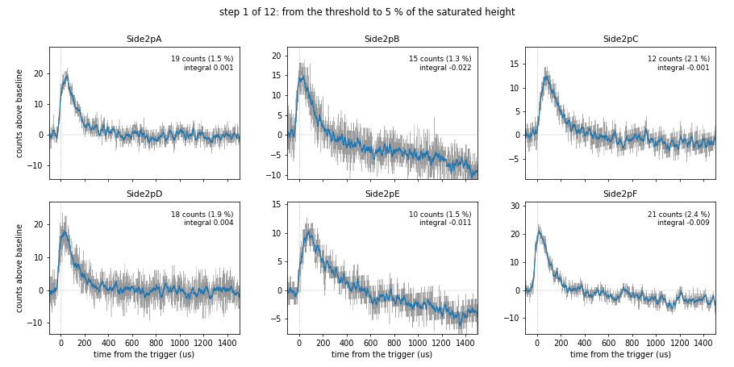
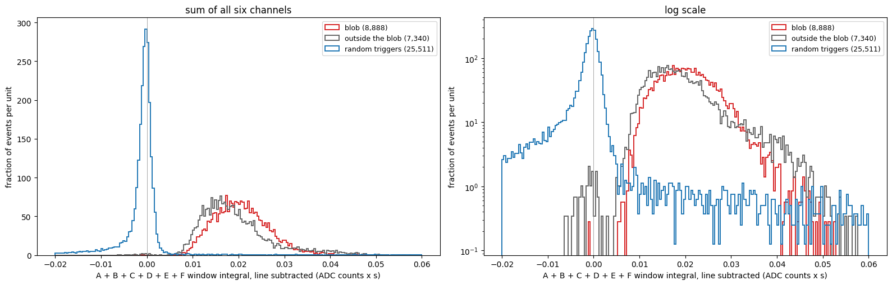

<!-- The clickable outline at the top of the published page is built from the ## headings below: do not write one. -->

## Code repository

The notebooks are in `data_analysis/R76/notebooks/relcal/` on the branch `feature/villano-relcal` (its README lists all of them). Pinned to the commit `a49e3e7`: the links show each notebook as it was at that commit, which may be older than the latest version, and the files may have moved since (see `data_analysis/README.md`).

- [`saturation-over-time.ipynb`](https://github.com/villano-lab/NSDF-Data/blob/a49e3e734833e48c0aaef10df31a93a1d4e1c451/data_analysis/R76/notebooks/relcal/saturation-over-time.ipynb) — the pulse height of each channel dump by dump along the run, the saturated height of each series, and the progression of pulses from the noise up to 15 % of the ceiling (with two movies). Run on the output made with the old, 500-sample baseline window.
- [`bstd-distribution.ipynb`](https://github.com/villano-lab/NSDF-Data/blob/a49e3e734833e48c0aaef10df31a93a1d4e1c451/data_analysis/R76/notebooks/relcal/bstd-distribution.ipynb) — the baseline noise `bstd` with the 500-sample window, and with the height and the integral.
- [`baseline-window-onset.ipynb`](https://github.com/villano-lab/NSDF-Data/blob/a49e3e734833e48c0aaef10df31a93a1d4e1c451/data_analysis/R76/notebooks/relcal/baseline-window-onset.ipynb) — where the pulse starts, in every channel, from the raw traces.
- [`bstd-distribution-450.ipynb`](https://github.com/villano-lab/NSDF-Data/blob/a49e3e734833e48c0aaef10df31a93a1d4e1c451/data_analysis/R76/notebooks/relcal/bstd-distribution-450.ipynb) — `bstd` after the reprocessing with the 450-sample window, the two windows compared, and the pulse evolution with a `bstd` cut (a movie, `figures/pulse-evolution-450.gif`, also in this note as Figure 6).
- [`positions-small-quiet-82v.ipynb`](https://github.com/villano-lab/NSDF-Data/blob/a49e3e734833e48c0aaef10df31a93a1d4e1c451/data_analysis/R76/notebooks/relcal/positions-small-quiet-82v.ipynb) — the delay position of the small events that pass the `bstd` cut.

The last section, *The small events re-centred: a blob, and the drift of the baseline*, comes from a later version of the position notebook, pinned to the commit `bebbaba`:

- [`positions-small-quiet-82v.ipynb`](https://github.com/villano-lab/NSDF-Data/blob/bebbaba3d00cdfd42bc83da4dffda233d8b9d91b/data_analysis/R76/notebooks/relcal/positions-small-quiet-82v.ipynb) (at `bebbaba`) — the plane of the delays re-centred on the large circle of events, the cut on the blob of small events, and the short-window integrals and filtered heights with a straight line subtracted, for one channel, the inner four and all six.

The processing is [`r76-82v-dcrc1pb.dataset.toml`](https://github.com/villano-lab/NSDF-Data/blob/a49e3e734833e48c0aaef10df31a93a1d4e1c451/data_analysis/R76/processing/r76-82v-dcrc1pb.dataset.toml) with the readout in [`registry/readouts.toml`](https://github.com/villano-lab/NSDF-Data/blob/a49e3e734833e48c0aaef10df31a93a1d4e1c451/registry/readouts.toml). The processed files are not in the repository: they are written to `~/goldsluice-output/r76-82v-dcrc1pb/`.

## Data and setup

**The series.** Eight series of Run 76 (Side-2 readout, detector `NAI-S2`, six phonon channels `Side2pA` to `Side2pF`) that trigger on the phonon channel DCRC1 pB, which is `Side2pF`, with a threshold of 10 (`DCRC1pB 10` in `series_lists/nsdf_r76_series.csv`). The high voltage is between -82.2 and -81.6 V. 436 dumps, about 36 GiB of raw data, downloaded from NSDF to `~/idx`.

| series | start (month-day hour:minute, 2022) | high voltage (V) | dumps | events |
|---|---|---|---|---|
| 07221111_2153 | 11-11 21:53 | -82.2 | 55 | 185,413 |
| 07221112_0943 | 11-12 09:43 | -82.2 | 101 | 347,850 |
| 07221112_2249 | 11-12 22:49 | -82.1 | 69 | 235,967 |
| 07221113_1159 | 11-13 11:59 | -82.0 | 45 | 147,856 |
| 07221114_2141 | 11-14 21:41 | -81.8 | 37 | 124,574 |
| 07221115_0845 | 11-15 08:45 | -81.7 | 33 | 108,094 |
| 07221115_2109 | 11-15 21:09 | -81.7 | 51 | 169,864 |
| 07221116_1003 | 11-16 10:03 | -81.6 | 45 | 146,731 |

In all, 1,466,349 events: 1,436,655 with the trigger label `Unknown` and 29,694 with `Physics`. In these dumps the label `Physics` behaves like a random trigger (almost no pulse) and `Unknown` like a real trigger; that is the working assumption of `goldpan.cuts` (Note 2a) and is not confirmed against the DAQ. **"Real triggers" below are the events labelled `Unknown`.**

**The processing.** `goldsluice run` with the seven algorithms of `r76-82v-dcrc1pb.dataset.toml`, one record per event and channel: `adc_max`, `current_max`, `max_time_s`, `baseline_mean`, `baseline_std`, `integral`, `max_deviation`, `excursion_ratio`, `rise_time_s` and `crossing_time_s` (the 20 % time of the rise). The unit of the pulse sizes is the ADC count: **nothing is calibrated** (`amps_per_adc` is 1). The baseline is the mean of samples 10 to 500 for the first part of the analysis and samples 10 to 450 after the reprocessing (see below); each trace has 4096 samples of 0.8 us and the trigger is at about sample 500.

**Quantities.** *Height* is `current_max`: the largest sample above the baseline, in counts. *`bstd`* is `baseline_std`: the standard deviation of the baseline window, in counts. The *saturated height* of a channel is the 99.99th percentile of the height of its real triggers, taken per series and then the median over the series.

## The question

What does the -82V R76 self-triggered data look like overall? A key string of series in the R76 run has the Pu/Be source out and alternates between self-triggered (Channel F) data and sodium-iodide-array (NaI) triggered data. The NaI triggered data will be good for searching for coincident neutron capture events but the self-triggered data will be crucial for calibration. I take an initial look--although Matt Fritts has looked before--at the dataset to see if I can identify clean pulses and the basic event characteristics. In other words, how clean is this data? 

## Every channel saturates, at its own height

The largest pulse height of each channel stops at a ceiling, and the ceiling differs between the channels. Figure 1 shows the 99th percentile of the height of the real triggers of each dump (the blue line) along the eight series, with the largest height of the dump as faint dots; the glitches of several thousand counts above the plateau are cut off by the vertical scale.

The saturated heights of the reprocessed output, in counts, are A 1278, B 1096, C 590, D 932, E 681 and F 884 (the first part of the analysis used 1277, 1095, 589, 930, 680 and 883 from the old processing; the difference is a few counts). The largest integral that a pulse can have is the saturated height held for the 2.88 ms that remain of the trace after the pulse starts: A 3.7, B 3.2, C 1.7, D 2.7, E 2.0 and F 2.5 counts x s. The integral of every channel ends at this ceiling.

Per series, the saturated height (counts) is:

| series | A | B | C | D | E | F |
|---|---|---|---|---|---|---|
| 07221111_2153 | 1277 | 1110 | 599 | 948 | 691 | 886 |
| 07221112_0943 | 1272 | 1105 | 596 | 941 | 686 | 883 |
| 07221112_2249 | 1256 | 1086 | 576 | 923 | 667 | 862 |
| 07221113_1159 | 1046 | 828 | 343 | 708 | 439 | 619 |
| 07221114_2141 | 1334 | 1110 | 605 | 944 | 697 | 895 |
| 07221115_0845 | 1342 | 1109 | 609 | 943 | 700 | 917 |
| 07221115_2109 | 1317 | 1087 | 584 | 924 | 677 | 886 |
| 07221116_1003 | 1279 | 1050 | 543 | 887 | 635 | 842 |

Seven series agree within about 5 percent for most channels (C and E are 7 to 8 percent below the median in the last one). The series `07221113_1159` is the outlier: every channel is at 58 to 82 percent of the median, and inside the series the heights dip to about 30 percent of normal, recover to about 60 percent and fall again (Figure 1). It does not follow the high voltage (-82.0 V is between -82.1 and -81.8 V). It is **left out of everything that follows that is about the pulses** (the baseline noise below keeps it).

The ceiling is not the full range of the ADC. The absolute `adc_max` of the largest pulses is about 4,260 counts for A and 3,570 to 3,580 for C in the series `07221111_2153` and `07221113_1159`, while the baseline of A is 3186 in one and 3494 in the other (9 percent), so the height above the baseline mixes the ceiling and the baseline. The ceiling in the absolute value is much steadier (A: 4267 and 4261) than the height above the baseline (1277 and 1046). In a scan of clean pulses ordered by their integral, from 1 to 15 percent of the ceiling (`saturation-over-time.ipynb`), channels A and B grow as one family of pulses up to 15 percent, while C, E and F turn, above 6 to 8 percent, into low flat-topped pulses of 90 to 190 counts that decay slowly: flat tops that are **well below** the saturated height. I have not found what sets that plateau.

## The baseline noise, and a baseline window that contained the pulse

`bstd` should be the noise of the baseline and not depend on the pulse. With the baseline window of the processing, samples 10 to 500, it did: the median `bstd` of the real triggers was far above that of the random triggers in four of the six channels, and the height against `bstd` showed a ridge in which `bstd` grows with the height, most clearly in Side2pF.

The test is on the raw traces, Figure 2 and Figure 3. For one dump of each series (7 dumps, 23,714 real triggers), the *onset* of the pulse is the first sample at which the trace smoothed over 16 samples rises above 5 times the smoothed noise of samples 10 to 400. For pulses above 15 percent of the saturated height the median onset is at sample 483 to 486 in all six channels, and 94 to 100 percent of them start before sample 500. The rising edge takes about 10 samples, so the last 15 samples of a window that ends at 500 hold it. The median `bstd` of samples 10 to 500 is 10.3 (A), 13.3 (B), 2.2 (C), 13.5 (D), 2.3 (E) and 7.9 (F) counts, against 2.0, 3.0, 1.6, 3.1, 1.7 and 1.8 for samples 10 to 400.

The events above the ridge are a different problem: a baseline that slopes across the window, by 100 to 150 counts in the traces I looked at. A trace in about 4 to 7 percent of the events (by channel) has a `bstd` of the early window more than 5 times the median, which are the same kind of event. Those are the events a quality cut should remove.

The baseline window of the readout in the detector registry was therefore shortened **from 500 to 450 samples** (`pretrigger_samples` of `DCRC_RUN76` in `registry/readouts.toml` and in `goldpan.config`, with this evidence in the record), and the eight series were reprocessed. Figure 4 shows `bstd` of the real triggers with both windows for the same events. The median is now the same as that of the random triggers in every channel (2.04, 3.07, 1.59, 3.15, 1.68 and 1.76 counts against 2.05, 3.08, 1.60, 3.16, 1.69 and 1.77). The share of the real triggers above twice the median `bstd` of the random triggers fell from 76, 59, 25, 69, 39 and 94 percent (A to F) to 15, 11, 10, 9, 12 and 13 percent. The ridge of height against `bstd` is gone.

The long tail of `bstd` (to 250 to 540 counts, for real and random triggers alike) is not a pulse effect: it is whatever disturbs the baseline of a trace, such as activity before the trigger, a glitch or a drift. The cut used below is the one the plots suggest: only events whose `bstd` is **below twice the median `bstd` of the random triggers of the channel** (A 4.10, B 6.15, C 3.20, D 6.31, E 3.37, F 3.54 counts). It is a choice and not a fit.

## How a pulse grows from the threshold

With the baseline clean, how does a pulse change as it grows from the smallest ones to 5 percent of the saturated height? For each channel the notebook takes twelve steps, spaced geometrically in the height, from the *threshold* of the channel to 5 percent of its saturated height (64, 55, 29, 47, 34 and 44 counts for A to F), and chooses one clean pulse at each. The threshold is where clean pulses begin, the 2nd percentile of the height of the clean pulses: 19, 15, 12, 18, 10 and 21 counts for A to F. Below it there are almost no clean pulses that peak at the trigger (the series trigger on Side2pF at a threshold of 10). The traces are filtered with `subtract_line` (the line fitted to samples 10 to 450 is subtracted) and smoothed over 16 samples for the height, and a pulse is called clean when it has a quiet baseline (and passes the `bstd` cut above), peaks in the 150 samples after the trigger, does not rise again by more than 5 percent of its height plus 6 times the noise in the 800 samples after the peak, has nothing larger than half its height after that, and is below half the saturated height. The pool is 21 dumps (3 of each series, without `07221113_1159`), 72,585 events, with 6,900 to 9,300 clean pulses per channel.

The pulses of A, B, D and F are sharp spikes with a fast rise and a fast fall, and look the same at every step, only larger; the smallest ones are 5 to 13 times the noise of the baseline (10 to 21 counts against 1.5 to 3). The pulses of C and E are broader and flatter at the same heights. I did not see saturation, a second pulse or a baseline step in these 72 pulses. **These are the cleanest pulses, picked by the criteria above, not typical ones.**

## The position of the small, quiet events

The position on the face can be made from the delays between the 20 % rise times of the channels (`xdel = t_E - (t_C + t_D) / 2 - 1 us`, `ydel = 0.866 (t_D - t_C) + 9 us`, `afdel = t_F - t_A`, after Matt Fritts's analysis in the UMN `R76Analysis` repository; the offsets are the empirical ones of that code, and the times are of the raw traces, not filtered). Selecting the events that pass the `bstd` cut in **all six channels** and have **no channel above 5 percent of its saturated height** gives:

| step | events |
|---|---|
| real triggers (without `07221113_1159`) | 1,292,982 |
| `bstd` below the cut in all six channels | 1,088,121 |
| no channel above 5 % of its saturated height | 19,671 |
| six 20 % times | 17,561 |
| one pulse (the six times within 60 us of their median) | 16,228 |

This distribution is **not on the face**. It sits at large `xdel` (median 20.6 us, 16 to 84 percent from 11.4 to 30.5 us), with `ydel` near 0 (median -0.8 us), outside the face that is drawn at the placeholder scale (about 14 us in radius); `phidel` is one peak at 0 degrees and `afdel` peaks at about -8 us. None of the two spots seen with the large events is visible. A condition that every channel has a pulse of at least 6 times its `bstd` keeps 10,951 of the 16,228 events (67.5 percent) and gives the same picture, so this is not only events in which a channel has no pulse.

## The small events re-centred: a blob, and the drift of the baseline

**A larger circle sets the centre and the scale.** When the cut on the size is raised from 5 to 15 or 30 percent of the saturated height, the small events of Figure 7 sit inside a larger, roughly circular distribution, whose outer edge is centred at about `xdel` = -1.5 us and `ydel` = +6 us with Fritts's offsets and has a radius of about 28 us. I took that circle as the face: the offsets became `xdel = t_E - (t_C + t_D) / 2 + 0.5 us` and `ydel = 0.866 (t_D - t_C) + 12 us` (within 1.5 and 3 us of Fritts's -1 and +9 us), and the detector is drawn with a radius of 28 us instead of the placeholder 14 us. The circle was fitted by eye to the edge, and **that it is the edge of the face is an assumption**. With that scale the events that pass only the `bstd` cut, which are mostly large pulses, fill the drawn face, with the two high-activity spots over C and next to the centre disc (Figure 8, left). The small, quiet events form a blob near the left edge of the face, at the C/D boundary, at `xdel` of about +22 us and `ydel` of about +2 us (Figure 8, right).

**The blob.** The density of the small, quiet events is highest at (`xdel`, `ydel`) = (22, 2) us, halves about 7 us from there and falls to a quarter at about 10 us. A circle of 10 us around that point holds 8,888 of the 16,228 events (55 percent); the other 7,340 are the comparison (Figure 9).

**The integral of a small pulse is dominated by the drift of the baseline.** The Side2pF `integral` of the processing (the whole trace, the mean of samples 10 to 450 as the baseline) is negative for almost all of these events, in the blob (median -0.007 ADC counts x s) and outside it (median -0.011) alike (Figure 10). The raw traces show why: the pulses are real, 20 to 40 counts high and back to the baseline in about 200 us, but after them the baseline drifts down by 5 to 40 counts over the 3 ms of the trace. A pulse of that size is worth about +0.005 ADC counts x s, the drift -0.01 to -0.05.

**A short window, with a straight line fitted and subtracted.** These quantities are not in the processed data, so they were computed from the raw dumps with `goldpan` (the `idx` reader and `goldpan.algorithms.lowpass`), for every channel, for the small, quiet events and the 25,511 random triggers, in one pass over the 391 dumps (about an hour; the result is cached next to the event cache):

- the integral over samples 480 to 1125 (16 us before the trigger to 500 us after it) instead of the whole trace;
- the same after a **straight line** is fitted to the pretrigger samples (10 to 450) **and** to the late tail (from 1.5 ms after the trigger to the end), leaving the pulse out, and subtracted, so that the line follows the drift under the pulse (unlike `subtract_line`, which fits the pretrigger only);
- the height after the same line is subtracted and the trace is filtered (`lowpass`, 50 kHz, zero phase).

With the window the pulses come out positive, and with the line the random triggers are centred on zero (Figure 11). Side2pF, medians: the line-subtracted window integral is 0.0049 for the blob, 0.0042 outside it and -0.0001 for the random triggers; the filtered height is 29, 24 and 2 counts. The blob is about 15 to 20 percent larger in Side2pF than the other small events, and its events lie on a single band of integral against height (about 0.00017 ADC counts x s per count, an effective length of about 170 us). Outside the blob there are, besides that band, a steeper one at heights of 8 to 20 counts with about 1.5 times the integral per count (longer pulses), and a few events with no pulse in Side2pF at all.

**Summed over the channels.** Summed over the four inner channels (C, D, E and F) the line-subtracted window integral has a median of 0.0146 for the blob and 0.0127 outside it; summed over all six, 0.0202 and 0.0178 (Figure 12). The outer rings A and B carry about 28 percent of the sum in both sets, and the inner and outer sums grow together along one narrow band. The steep group outside the blob reaches about twice the sum of the main band at the same Side2pF height: it carries much more in C, D and E relative to F, as an event far from the centre would. The channels are summed with equal weights and nothing is calibrated.

## What is not done, and what could be wrong

- **The times of small pulses.** The 20 % time is taken from the raw trace. For pulses of 20 to 60 counts against a noise of 2 to 3, the times may be biased and not only noisy. The heights and integrals of the last section are taken after a line is subtracted and the trace is filtered, but the **times** are not yet: the delays of small events, and so the blob, are still those of the raw traces.
- **The centre and the scale of the face.** The large circle of events is taken to be the edge of the face, fitted by eye; neither the offsets nor the radius are derived, and the delays are not converted to millimetres.
- **The short-window quantities** are computed in a notebook from the raw dumps, not by the processing; the window (samples 480 to 1125) and the line (fitted to samples 10 to 450 and from 1.5 ms on) are choices.
- **The cut.** `bstd` below twice the random-trigger median is a first choice. 10 to 15 percent of the real triggers are above it, and what those events look like (activity before the trigger, glitches, drift) has not been checked trace by trace.
- **The onset test** uses one dump of each series and one definition of the onset (5 times the smoothed noise). The conclusion that the edge is inside a window to sample 500 does not depend on it much, but the numbers (sample 483 to 486) do.
- **The saturated heights** are heights above the baseline, not absolute ADC values. The flat tops below the ceiling in C, E and F, and why the ceilings differ between the channels, are not explained.
- **The series `07221113_1159`** is left out of the pulse analysis because every channel is low in it. Why is not known; it does not follow the high voltage.
- **Nothing is calibrated.** Heights and integrals are in ADC counts, and the channels are not yet set against each other, which is what the `relcal` notebooks are for.
- **The readout** is assumed to be the same for all eight series as for `07221203_2025` (`DCRC_RUN76`: 0.8 us per sample, trigger at about sample 500); the pulse position was checked in the dumps of this note only through the onset test above.
