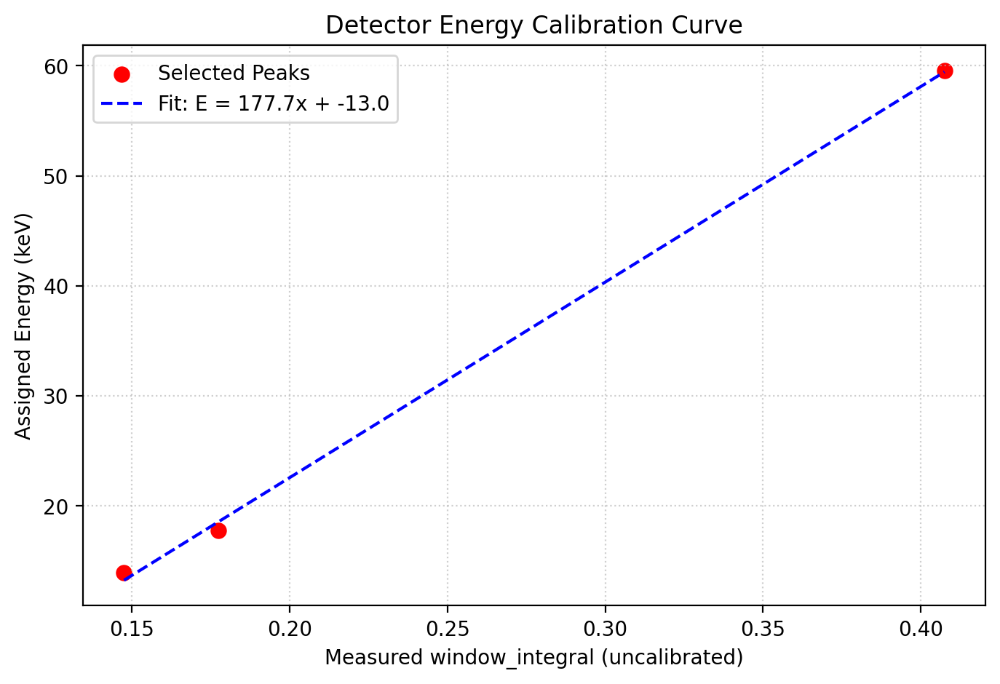

## What We're Doing & Why
The main goal here is to figure out how to translate raw detector signals into actual physical energy units (keV) using an Americium-241 isotopic source. By hunting down the known gamma and X-ray peaks in our data, we can build a reliable conversion curve.

## Data & Setup
- **Dataset:** Run 76 Parquet file pulled via `nsdf-cli`.
- **Detector / Channel:** Detector 0, Channel A.
- **Quick Fixes:** We had to apply a baseline gate to flatten out some diagonal slanting caused by baseline drift, which instantly made the peaks pop way cleaner.

## Results & Calibration Curve
After matching up our trusted peak pairs—specifically the 13.95 keV Np L-alpha, 17.8 keV Np L-beta, and the main 59.54 keV gamma ray—we ran a quick linear fit.

- **Calibration Equation:** $E \approx 177.7x - 13.0$

**Figure 1. Energy calibration curve showing measured window integral vs. assigned physical energy (keV) with a linear fit.**

## Pinned Code
The Jupyter notebook behind these numbers and plots is permanently locked in via Git:
- [`first-analysis-acetrujillo.ipynb`](https://github.com/villano-lab/NSDF-Data/blob/fb4d75810a9692e9c4a4763d750b7b2f7c84bdd2/data_analysis/R76/student/acetrujillo/first-analysis-acetrujillo.ipynb) — the notebook for everything below. Pinned to `fb4d75810a9692e9c4a4763d750b7b2f7c84bdd2`: the link shows the notebook as it was at that commit.

## Things We're Still Figuring Out
The big three peaks lined up with the fit super nicely. That said, we noticed a few smaller, unexplained bumps showing up at higher window integrals. We aren't entirely sure yet if they're background noise, escape peaks, or something else entirely.
