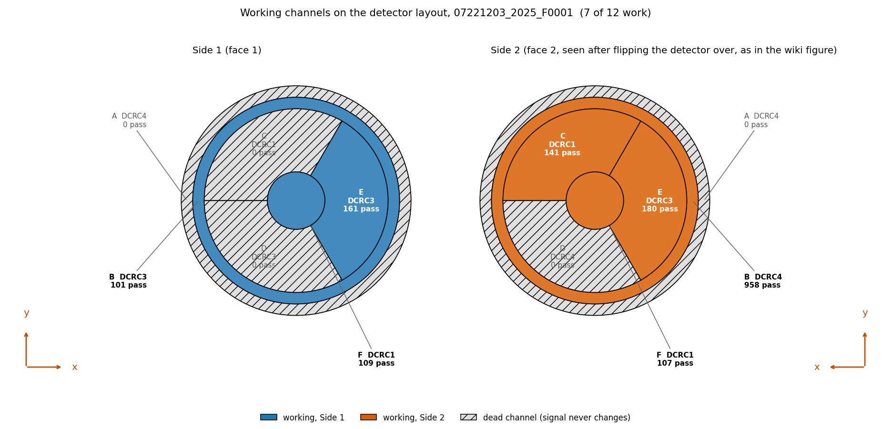
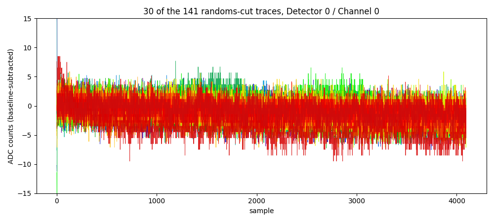

## Code repository

- [`noise-psd-randoms-buddy.ipynb`](https://github.com/villano-lab/NSDF-Data/blob/fb4df33/data_analysis/R76/student/buddy/noise-psd-randoms-buddy.ipynb) — the notebook for everything below. Pinned to `fb4df33`: the link shows the notebook as it was at that commit, which may be older than the latest version, and the file may have moved since (see `data_analysis/README.md`).

## Data and setup

We are using the file 07221203_2025_F0001, which is series 07221203_2025, Dump 1. The first 1000 events are ``random'' triggers (the ``Beginning of Run Randoms'', taken at about 20 Hz: 1000 events in 49 seconds); random triggers are snapshots of our detector traces taken at any time (rather than when a pulse occurs) to sample the noise environment. The line in the third code block of the `noise-psd-randoms-buddy.ipynb` notebook shows the randoms cut defined as `quiet_noise = pc.excursion_band(pulses, config_500) & (np.log10(bstd_500) < 0.5)` in addition to selecting the trigger specification for random events. The other 8 of the 1008 events that carry the randoms label are ``in-run'' randoms: they are spread through the rest of the dump, about one per second (8 in the last 9 seconds; the timestamps have one-second resolution). The run configuration of series `07220916_2200` lists 5 Hz for in-run randoms, which does not match what we see here, so that rate should not be assumed for this series. 

::: callout
**Note.** The trigger specifications have the wrong wording (see [Note 2a](https://villano-lab.github.io/NSDF-Data/notes/note-02a-bstd-vs-time.html#randoms))
:::

It may also be useful to have a diagram of the detector and which channels are working during the R76 run period at UMN. The figure below was reconstructed from the archive of the [UMN Wiki](https://villano-lab.github.io/R76Analysis/index.html). 

**How we found which channel is which.** The data are numbered by detector (0 to 2) and channel (0 to 3), but there is one detector, S104, read out by three four-channel electronics boards (DCRC1, DCRC3, DCRC4). We matched them to the detector's channels in four steps:

1. **The channel table.** The *Setup* table of the [UMN Run 76 summary](https://villano-lab.github.io/R76Analysis/cdms/k100/run_summary/run_76.html) lists the 12 channels by board, with the detector channel in its Label column (`Side1pA` to `Side2pF`). We used that column. The HV columns repeat entries and look like typos.
2. **The board order.** The table does not say which board is detector 0, 1 or 2. The raw file of another Run 76 series (`07220916_2200`; the raw file for our series is not on NSDF) holds the run configuration. It enables boards DCRC1, DCRC3 and DCRC4, and the three records of each event carry the codes 9, 11 and 12, which are the board numbers plus 8. So detector 0, 1, 2 = DCRC1, DCRC3, DCRC4. This is inferred and not confirmed.
3. **The channels within a board.** We assumed they follow the table's row order. The data agree: the channels that read a constant value (channel 2 of DCRC1 and DCRC3, and channels 1 to 3 of DCRC4) are the ones that configuration lists with zero QET bias.
4. **The faces.** The wiki's source-position figure draws Side 2 as seen after flipping the detector over, which is how the figure below shows it.

The mapping is kept in [`python/pulse_channels.py`](https://github.com/villano-lab/NSDF-Data/blob/fb4df33/python/pulse_channels.py), marked as under development, and section 7 of the notebook gives the evidence.

## The question

Based on this series' "Beginning of Run Randoms (BORR)," what is our best estimate for the noise environment of the experimental setup? The noise environment is typically summarized in terms of the Power Spectral Density (PSD).

## Selection of Randoms in All Channels

Typically, BORR are taken in the first events of the first "dump" (file) of a series' raw data. In this series that is the case and there are 1000 BORR. Often many of the initial traces are "contaminated" with a real physics pulse that just happened to be in the random's readout window. We call this a "pileup" pulse. Those occurances can mess up the noise computation and therefore the Optimal Filter amplitudes. Here I describe how we make a cut on the data to be sure those pileups are removed. 

This sort of thing has been done on one channel, Detector 0 / Channel 0, and it is the topic of [Note 2](https://villano-lab.github.io/NSDF-Data/notes/note-02-noise-selection.html) and [Note 2a](https://villano-lab.github.io/NSDF-Data/notes/note-02a-bstd-vs-time.html). Note 2 develops the noise-pulse selection: an excursion cut on a 500-sample pretrigger window (the Tight band) together with a cut on the baseline scatter, `log10(bstd) < 0.5`, which keeps 179 of the 1517 traces. Note 2a adds the trigger cut that keeps only the randoms, 141 of those 179 (the other 38 are real triggers), and looks at how the baseline scatter changes with time. 

To use that cut I have to decide how to apply it to all of the channels. A pileup should show up in all channels simultaneously, because the origin is a real physics event. It is possible the amplitude in some channels could be small enough so that it's not obvious. 

## Reading

## Caveats

## Next steps
