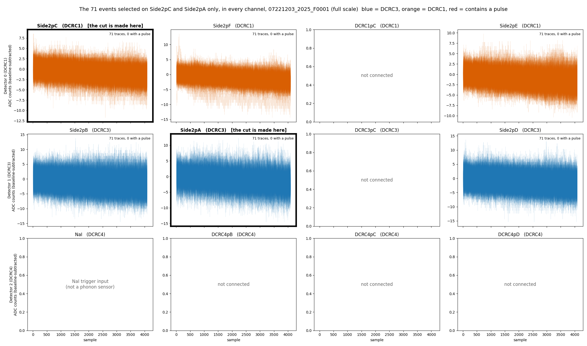
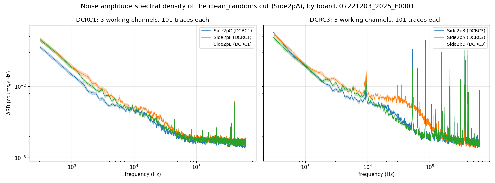
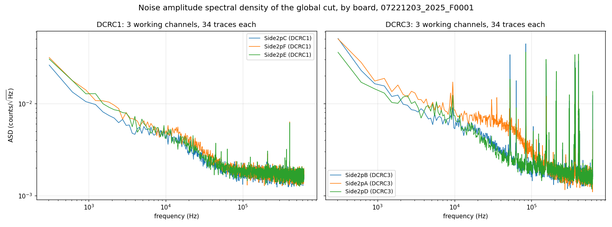
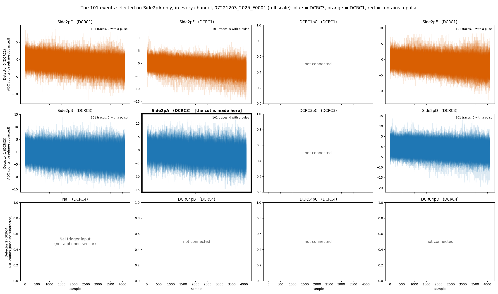

::: callout
**WARNING (22 October 2026): the sample time has changed.** The phonon sample period is **0.8 µs (1.25 MHz), not 1.6 µs (625 kHz)**; a 4096-sample trace is 3.2768 ms. This note, its figures and its HDF5 file were made with 1.6 µs until 2026-10-22, which was wrong (see *The sample period* in `python/README.md`). What changed in this note: <!-- numbers-ok -->

- The frequency axis of Figures 4 and 6 now reaches 625 kHz (it ended at 312 kHz); every frequency is twice what it was, so a feature the old figures showed at 100 kHz is at 200 kHz. The frequency bins are 306 Hz apart (153 Hz before), from 306 Hz to 625 kHz. <!-- numbers-ok -->
- The PSD is divided by 2 and the amplitude spectral density by $\sqrt{2}$ (the factor $\Delta t$ in the definition), so the ASD values quoted for Figure 4 changed: the plateau above 100 kHz is 1.70e-3 to 1.74e-3 counts/√Hz in the three DCRC1 channels (it was 2.37e-3 to 2.59e-3 in five channels), and between 1 and 10 kHz the six sensors are at 6.29e-3 to 1.10e-2 counts/√Hz (6.71e-3 to 1.23e-2 for the six, with the input now known to be the NaI trigger at 2.61e-3, before). The channel names in this line are those of the channel-map box below. Because the bands 1 to 10, 10 to 100 and above 100 kHz stay the same while the frequencies doubled, they now cover different parts of the spectrum. <!-- numbers-ok -->
- $\Delta t$ in the PSD definition is 0.8 µs, the code block no longer sets `sample_period_s` (the library default is used), and the HDF5 file `psd-clean-randoms-07221203_2025_F0001.h5` has `sample_period_s` = 8e-07 and the frequencies of the new axis, so any analysis that used its frequencies must be redone. <!-- numbers-ok -->
- Unchanged by the sample time: everything counted in samples or counts (the cuts, the 101 and 141 events (the strictest cut's 31 is now 34, see the next box), the traces and pulse heights in all the figures other than 4 and 6 (they are identical pixel for pixel), the sample numbers quoted for the events). <!-- numbers-ok -->
- The Code repository section is pinned to the commit of the latest re-run (`21b4669` for the notebooks, figures and file, `ade25df` for the library). <!-- numbers-ok -->
:::

::: callout
**WARNING (22 October 2026): the channel map has changed.** The table columns used for the channel names were the wrong ones for this series. It is read out on **Side 2**, so one uses the *Label* and *HV output, Side 2 readout* columns of the Run 76 Setup table: there are **six sensors, all on Side 2**, on DCRC1 and DCRC3; DCRC4 pA is the **input of the NaI trigger signal** and the other five inputs are not connected (`python/pulse_channels.py`, since 2026-10-22). What changed in this note: <!-- numbers-ok -->

- **The channel names.** The dump channel (0, 3) was `Side1pF` and is `Side2pE` (PES2); (1, 0) was `Side1pE` and is `Side2pB` (PBS2); (1, 1) was `Side1pB` and is `Side2pA` (PAS2); (1, 3) was `Side2pE` and is `Side2pD` (PDS2); (2, 0) was `Side2pB` (PBS2) and is the NaI trigger input. `Side2pC` (PCS2, 0 / 0) and `Side2pF` (PFS2, 0 / 1) are as before. Everything keyed by (detector, channel), the cuts, the event numbers and counts, is unchanged. <!-- numbers-ok -->
- **No Side 1.** Figure 1 shows one face with six regions instead of two faces with seven working channels; the colours of the other figures are by board (blue DCRC3, orange DCRC1), and the by-side figures (4, 6) are by board; Figures 3 and 8, and the text about the cut "on one channel of each side", are now about one channel on each board. <!-- numbers-ok -->
- **The cut we use is made on PAS2** (the old PBS1), a channel of DCRC3. Its 101 events are the same. <!-- numbers-ok -->
- **PBS2 is gone as a phonon channel.** The caveat about it (flat, low spectrum, maybe superconducting) is replaced: DCRC4 pA is the NaI trigger input. <!-- numbers-ok -->
- **Numbers that changed.** The strictest cut (every working channel) keeps **34** randoms, it was 31: three randoms failed only in the NaI input, which is no longer one of the channels. The amplitude of each sensor is the same as before under its new name; the 101-to-34 comparison and the lists of channels changed with the names. In the HDF5 file, the six channel groups are `Side2pA` to `Side2pF` (the old `Side1pB` group is `Side2pA`), with `side` = 2 and the new attributes `board_input` and `hv_output`; the NaI input has no group. <!-- numbers-ok -->
- **Not settled.** The A/B order on DCRC1 is the table's (A is `Side2pC`, B is `Side2pF`); the explanatory text next to the table writes it the other way round, which we take to be a typo (the Trello page of the notebook carries a marked copy). The board order and the Side-2 readout of the December series are inferred (Data and setup). <!-- numbers-ok -->
:::

## Code repository

All code is pinned to two commits: buddy's notebooks, the saved HDF5 file and the figures to `21b4669`, the commit of the re-run with the corrected sample period (0.8 µs) and the channel map of the Side-2 readout, and the library in `python/` to `ade25df`. Each link shows the file as it was when the results below were made, which may be older than the latest version, and the file may have moved since (see `data_analysis/README.md`). On the published page a small "latest" link after each one opens the file on `develop` today.

- [`psd-clean-randoms-buddy.ipynb`](https://github.com/villano-lab/NSDF-Data/blob/21b4669/data_analysis/R76/student/buddy/psd-clean-randoms-buddy.ipynb): the spectra of every channel from the `clean_randoms` cut, and the saved HDF5 file [`psd-clean-randoms-07221203_2025_F0001.h5`](https://github.com/villano-lab/NSDF-Data/blob/21b4669/data_analysis/R76/student/buddy/psd-clean-randoms-07221203_2025_F0001.h5) (Noise Power Spectral Densities).
- [`chan0-cut-on-all-channels-buddy.ipynb`](https://github.com/villano-lab/NSDF-Data/blob/21b4669/data_analysis/R76/student/buddy/chan0-cut-on-all-channels-buddy.ipynb): how good the PCS2 cut (the channel names are explained under Data and setup) is on the other channels, and the definition of the cut we use (`clean_randoms`) (Selection of Randoms in All Channels, Data and setup for the timing of the randoms, Appendices A and B).
- [`noise-psd-randoms-buddy.ipynb`](https://github.com/villano-lab/NSDF-Data/blob/21b4669/data_analysis/R76/student/buddy/noise-psd-randoms-buddy.ipynb): the channel map and the noise spectra of the 34 events of the strictest cut (Data and setup, Appendix A).
- [`extract_odb_facts.py`](https://github.com/villano-lab/NSDF-Data/blob/21b4669/data_analysis/R76/student/buddy/extract_odb_facts.py) and [`odb-facts-07220916_2200.json`](https://github.com/villano-lab/NSDF-Data/blob/21b4669/data_analysis/R76/student/buddy/odb-facts-07220916_2200.json): the run configuration of series `07220916_2200` (board order, QET biases, random rates) read from its raw file, which is not in the repository, and the numbers it gave; section 12 of `noise-psd-randoms-buddy.ipynb` prints them (Data and setup, Caveats).
- [`pulse_channels.py`](https://github.com/villano-lab/NSDF-Data/blob/ade25df/python/pulse_channels.py), [`pulse_cuts.py`](https://github.com/villano-lab/NSDF-Data/blob/ade25df/python/pulse_cuts.py) and [`pulse_quantities.py`](https://github.com/villano-lab/NSDF-Data/blob/ade25df/python/pulse_quantities.py): the library for the channel names, the randoms and excursion-band cuts, and the PSD.

## Data and setup

We are using the file 07221203_2025_F0001, which is series 07221203_2025, Dump 1. The first 1000 events are "random" triggers (the "Beginning of Run Randoms," BORR, taken at about 20 Hz: 1000 events in 49 seconds); random triggers are snapshots of our detector traces taken at any time (rather than when a pulse occurs) to sample the noise environment. The line in the third code block of the [`noise-psd-randoms-buddy.ipynb`](https://github.com/villano-lab/NSDF-Data/blob/21b4669/data_analysis/R76/student/buddy/noise-psd-randoms-buddy.ipynb) notebook shows the randoms cut defined as `quiet_noise = pc.excursion_band(pulses, config_500) & (np.log10(bstd_500) < 0.5)` in addition to selecting the trigger specification for random events. The other 8 of the 1008 events that carry the randoms label are "in-run" randoms: they are spread through the rest of the dump, one every 1 to 2 seconds (all 8 in the last 9 seconds of the dump; the timestamps have one-second resolution). The run configuration of series `07220916_2200` lists 5 Hz for in-run randoms, which does not match what we see here, so that rate should not be assumed for this series. 

::: callout
**Note.** The trigger-type labels in the dump's `.csv` are the wrong way round. The column `trigger_type` has two values, `Physics` and `Unknown`. By their names one would read `Physics` as an event triggered by a pulse and `Unknown` as a trigger of undetermined type. In this dump it is the opposite: the first 1000 events, which are the Beginning of Run Randoms (the run configuration asks for 1000 randoms at 20 Hz, and these 1000 events span 49 s, which is 20.4 Hz), are all labelled `Physics`, and the other events, 509 in this dump, are labelled `Unknown`. So we take `Physics` to mean a random trigger and `Unknown` to mean a real (pulse) trigger, which is what `pc.randoms` and `pc.real_triggers` do. This is a working assumption: nothing in the data files or the DAQ documentation we have confirms it, and the two functions are tagged under development for that reason (see [Note 2a](https://villano-lab.github.io/NSDF-Data/notes/note-02a-bstd-vs-time.html#randoms)).
:::

It may also be useful to have a diagram of the detector and which channels are working during the R76 run period at UMN. The figure below was reconstructed from the archive of the [UMN Wiki](https://villano-lab.github.io/R76Analysis/index.html). 

**How we found which channel is which.** The data are numbered by detector (0 to 2) and channel (0 to 3), but there is one detector, S104, read out by three four-channel electronics boards (DCRC1, DCRC3, DCRC4). We matched them to the detector's channels in four steps:

1. **The channel table and the readout.** The *Setup* table of the [UMN Run 76 summary](https://villano-lab.github.io/R76Analysis/cdms/k100/run_summary/run_76.html) lists the 12 sensors of the detector with a Label (`Side1pA` to `Side2pF`) and, for a Side-1 readout and for a Side-2 readout, the HV connector pin each is wired to. Matt Fritts's explanation of the table (page 28 of the notebook N-MISC-23-001) says to use the *Label* and *HV output, Side2-readout* columns: HV1 and HV2 are the two D-subs the DCRCs plug into, and the header of a run-diary page from late in the run, when the detector was left in Side-2 readout, says that HV1 has DCRC3, HV2 has DCRC1 and the NaI trigger signal goes to DCRC4. The December 2022 series is after that change, so it is a Side-2 readout. (An earlier version of this note used the table's *DCRC (2-sided)* column and found twelve channels on two sides, which was wrong for this readout.)
2. **The pins.** In Side-2 readout HV2 pA, pB, pD are `Side2pC`, `Side2pF`, `Side2pE` (DCRC1) and HV1 pA, pB, pD are `Side2pB`, `Side2pA`, `Side2pD` (DCRC3); pC is not used. Matt's text next to the table writes the DCRC1 order as pF, pC, pE; the table and the 2022 diaries ("DCRC1pA = Side2pC") agree with each other, so we take the text to be a typo. This is not confirmed with Matt.
3. **The board order.** The table does not say which board is detector 0, 1 or 2. The raw file of another Run 76 series (`07220916_2200`; the raw file for series `07221203_2025`, the one analysed here, is not on NSDF) holds the run configuration. It enables boards DCRC1, DCRC3 and DCRC4, and the three records of each event carry the codes 9, 11 and 12, which are the board numbers plus 8. So detector 0, 1, 2 = DCRC1, DCRC3, DCRC4. This is inferred and not confirmed.
4. **The channels within a board.** We assumed the dump's channels 0 to 3 are the board inputs pA to pD in order. The data agree: the inputs whose signal never changes (channel 2 of DCRC1 and DCRC3, the pC inputs that Side-2 readout does not connect, and channels 1 to 3 of DCRC4) are the ones that configuration lists with zero QET bias, and DCRC4 channel 0, with its feedback disabled, is the NaI trigger input.

The mapping is kept in [`python/pulse_channels.py`](https://github.com/villano-lab/NSDF-Data/blob/ade25df/python/pulse_channels.py), marked as under development, and section 7 of *that* notebook, [`noise-psd-randoms-buddy.ipynb`](https://github.com/villano-lab/NSDF-Data/blob/21b4669/data_analysis/R76/student/buddy/noise-psd-randoms-buddy.ipynb), gives the evidence.

**Channel names.** In the text a channel is written as P, the letter of its sensor, and its side: PCS2 is the phonon channel C on Side 2. The library, the tile titles of the figures and the HDF5 file of the PSDs use the form `Side2pC` for the same channel, and the dump numbers it as detector 0, channel 0. The six sensors, all on Side 2:

| In the text | Library and figures | Dump (detector / channel) | Board and input |
|:-:|:-:|:-:|:-:|
| PCS2 | `Side2pC` | 0 / 0 | DCRC1 pA |
| PFS2 | `Side2pF` | 0 / 1 | DCRC1 pB |
| PES2 | `Side2pE` | 0 / 3 | DCRC1 pD |
| PBS2 | `Side2pB` | 1 / 0 | DCRC3 pA |
| PAS2 | `Side2pA` | 1 / 1 | DCRC3 pB |
| PDS2 | `Side2pD` | 1 / 3 | DCRC3 pD |

The other six inputs are not sensors: DCRC4 pA (dump 2 / 0) is the input of the trigger signal of the NaI array, and DCRC1 pC, DCRC3 pC, DCRC4 pB, pC and pD are not connected (their signal never changes).


**Figure 1: The six sensors of detector S104 on Side 2**, the face that is read out in this series (as seen after flipping the detector over). Each region is coloured by its readout board, DCRC1 (orange) or DCRC3 (blue), and labelled with its letter, its board and input, and the number of randoms that pass its own quiet-noise cut. The other six inputs are not on the detector.

## The question

Based on this series' Beginning of Run Randoms (BORR), what is our best estimate for the noise environment of the experimental setup? The noise environment is typically summarized in terms of the Power Spectral Density (PSD).

## Selection of Randoms in All Channels

Typically, BORR are taken in the first events of the first "dump" (file) of a series' raw data. In this series that is the case and there are 1000 BORR. Often some of the initial traces are "contaminated" with a real physics pulse that just happened to be in the random's readout window. We call this a "pileup" pulse. Those occurances can mess up the noise computation and therefore the extracted pulse amplitudes; pulse amplitudes are used to estimate the energy deposited in each event. Here I describe how we make a cut on the data to be sure those pileups are removed. 

This sort of thing has been done on one channel, PCS2, and it is the topic of [Note 2](https://villano-lab.github.io/NSDF-Data/notes/note-02-noise-selection.html) and [Note 2a](https://villano-lab.github.io/NSDF-Data/notes/note-02a-bstd-vs-time.html). Note 2 develops the noise-pulse selection: an excursion cut on a 500-sample pretrigger window (the Tight band) together with a cut on the baseline scatter, `log10(bstd) < 0.5`, which keeps 179 of the 1517 traces. Note 2a adds the trigger cut that keeps only the randoms, 141 of those 179 (the other 38 are real triggers), and looks at how the baseline scatter changes with time. 

To use that cut I have to decide how to apply it to all of the channels. A pileup should show up in all channels simultaneously, because the origin is a real physics event. It is possible the amplitude in some channels could be small enough so that it's not obvious. Figure 2 is a plot based on the cut for PCS2 only (see the [Data and setup](#data-and-setup) section). To my slight surprise I found that this cut *does not remove* some traces that are either glitches or tails of pulses in the DCRC3 channels. I don't want those pulses in the noise sample. 


**Figure 2: The 141 randoms that pass the PCS2 cut, in every channel.** One tile per channel (rows are the boards DCRC1, DCRC3 and DCRC4); the traces are drawn over each other with transparency, baseline-subtracted, on a free vertical scale. The cut is made on PCS2 (framed). Blue is DCRC3, orange is DCRC1, and red marks a trace that contains a pulse. The 6 tiles with grey text are the inputs that are not sensors. Several traces carry large baseline ramps in the DCRC3 channels even though they are quiet in PCS2.

Based on what was seen in Figure 2. I developed a cut that will select noise for PAS2. It will hopefully not be as strict as requiring the analogous cut to be true on *all* channels. That leaves only 34 traces (see [Appendix A](#appendix-a-the-strictest-cut-every-working-channel)). 

Instead of doing *all* channels I selected instead one channel on each board to apply the standard cut to and then took the logical "AND." In that case the remaining number of traces was somewhat small (71) but the quality looked pristine. 



**Figure 3: The randoms that pass the cut on one channel of each board, in every channel.** The cut is the quiet-noise cut on PCS2 (DCRC1) **and** on PAS2 (DCRC3), both framed. One tile per channel, with the traces drawn over each other with transparency on a free vertical scale. Blue is DCRC3, orange is DCRC1, and red would mark a trace that contains a pulse. The 6 tiles with grey text are the inputs that are not sensors.

While setting this up in the Jupyter notebook [`chan0-cut-on-all-channels-buddy.ipynb`](https://github.com/villano-lab/NSDF-Data/blob/21b4669/data_analysis/R76/student/buddy/chan0-cut-on-all-channels-buddy.ipynb), I checked if there were similar traces left in the DCRC1 channels after selecting on PAS2 (DCRC3), just like we saw in the DCRC3 channels after selecting on PCS2 (DCRC1). [Appendix B](#appendix-b-the-cut-on-pcs2-and-the-cut-on-pas2) shows the traces left in the DCRC3 channels after the PCS2 cut (Figure 7), and then the PAS2 cut itself (Figure 8). To my surprise there *were not* traces in the DCRC1 channels that were very apparent. That means that for some reason cutting on PAS2 is more pure than cutting on PCS2. Since cutting on PAS2 alone is also less restrictive than the combined cut by definition, this led to more accepted randoms (101, compared with 71 for one channel on each board and 34 for all channels).

**We will use this cut going forward:** the cut of Notes 2 and 2a (a random trigger in the Tight excursion band with `log10(bstd) < 0.5`) made on PAS2 (DCRC3). In the notebook it is defined in one place, `clean_randoms_cut`, and the selection it makes is called `clean_randoms`.

## Noise Power Spectral Densities

The key parameter we want to get out of pulses in these detectors is the overall "amplitude" because it should be proportional to the energy deposited in a scattering event. That's hard to do for the small signals (near the noise baseline) that we have for dark matter direct detection (the expected recoil spectrum rises roughly exponentially toward low energy, with no turnover; Lewin and Smith [1]) so we use an algorithm called the Optimal Filter (OF) (Gatti and Manfredi [2]; Golwala [3]; Press et al. [4]; Szymkowiak et al. [5]) instead of a simpler procedure like integrating the pulses. The crucial part of the OF is that it takes into account the electronic noise environment of the sensor, rather than blindly integrating. The noise is summarized by the Power Spectral Density (PSD) constructed with traces that have no pulses present--the ones we are selecting here.

The PSD is sort of like the standard deviation of different frequency components in a trace (any trace can be written as a sum of sinusoids of different frequencies, the Fourier decomposition [4]). The PSD can be calculated for discrete data sampling as below, by averaging the squared Fourier amplitudes of many traces (Welch [6]):

Take a trace of $N$ samples $x[n]$, $n = 0, \ldots, N-1$, taken every $\Delta t$ (here $\Delta t = 0.8\,\mu\mathrm{s}$), with its baseline subtracted. Its discrete Fourier transform is $X[k]$, with $k = 0, 1, \ldots, N/2$ ($N$ is even here), which are the non-negative frequencies, all that the one-sided PSD needs. Bin $k$ sits at the frequency $f[k] = k/(N\,\Delta t)$, from zero ($k = 0$) up to the Nyquist frequency $1/(2\,\Delta t)$ ($k = N/2$). Averaging over $M$ traces with no pulse in them (here the $M = 101$ traces of the `clean_randoms` cut, or the 34 of Appendix A), the one-sided PSD is

$$
\begin{aligned}
X_m[k] &= \sum_{n=0}^{N-1} x_m[n]\, e^{-2\pi i\, k n / N}, \qquad k = 0, 1, \ldots, N/2, \\
S[k] &= \frac{2\,\Delta t}{N}\cdot\frac{1}{M}\sum_{m=1}^{M}\left|X_m[k]\right|^2
\qquad \left(\mathrm{counts}^2/\mathrm{Hz}\right),
\end{aligned}
$$

where $x_m[n]$ is trace $m$ and $X_m[k]$ its transform. The amplitude spectral density is $\mathrm{ASD}[k] = \sqrt{S[k]}$, in counts/$\sqrt{\mathrm{Hz}}$. The factor 2 folds the negative frequencies onto the positive ones (it is left out for the zero-frequency and Nyquist bins), and the $1/N$ and $\Delta t$ make $S$ independent of the trace length and the sampling rate, so that its integral over frequency equals the mean square of the trace (its variance, if the trace has zero mean). Here $N$ = 4086, the length of a trace after the leading glitch samples are dropped, so there are 2044 bins, from 306 Hz (the first non-zero bin) to 625 kHz; the zero-frequency bin is not plotted. This is the convention used in the notebook ([`noise-psd-randoms-buddy.ipynb`](https://github.com/villano-lab/NSDF-Data/blob/21b4669/data_analysis/R76/student/buddy/noise-psd-randoms-buddy.ipynb)); Note 3 plotted the raw $|X[k]|^2$ instead, which differs from $S$ only by the constant $2\,\Delta t/N$.

**Conventions.** We use one-sided spectra: the PSD $S[k]$ above, in counts²/Hz, and the amplitude spectral density (ASD) $\sqrt{S[k]}$, in counts/$\sqrt{\mathrm{Hz}}$, which is the quantity the figures show and the usual way to quote noise. Golwala [3] (appendix B, pp. 409 to 418) uses a different convention in three ways. His Fourier transform has the factor $1/N$ on the forward transform (p. 412), so his $\tilde{v}_n$ is our $X[k]/N$. His PSD $J(f)$ is two-sided, with $\int_{-\infty}^{\infty} J(f)\,df$ equal to the variance (p. 415). He estimates it as $J = 2T\,|\tilde{v}|^2$, averaged over noise traces, with $2T = N\,\Delta t$ (p. 417); the averaging over traces is the same as ours. In our terms $J[k] = (\Delta t/N)\,|X[k]|^2 = S[k]/2$ for $0 < f < f_{\mathrm{Nyquist}}$, so his amplitude $\sqrt{J}$ is our ASD divided by $\sqrt{2}$. He also notes that the quantity usually quoted, $\sqrt{J}$, is often wrongly called the PSD (p. 415). The difference matters when the spectrum goes into the optimal filter, whose expected resolution is $\sigma_A^2 = \left[\int_{-\infty}^{\infty} |\tilde{s}(f)|^2/J(f)\,df\right]^{-1}$ for a pulse template $\tilde{s}$ (his equation B.1, p. 418). Written with our one-sided $S$ it is $\sigma_A^2 = \left[4\int_{0}^{\infty} |\tilde{s}(f)|^2/S(f)\,df\right]^{-1}$, and using $S$ in his formula unchanged would be off by a factor of 2. The template $\tilde{s}$ must use his scaling of the Fourier transform too. <!-- numbers-ok -->

Figure 4 shows the amplitude spectral density of the 101 events of the `clean_randoms` cut, the cut used from now on. Above 100 kHz it is flat, between 1.70e-3 and 1.74e-3 counts/√Hz in the three DCRC1 channels PCS2, PFS2 and PES2; the narrow lines of the DCRC3 channels raise their means to 1.98e-3 (PAS2), 2.64e-3 (PBS2) and 2.93e-3 (PDS2) counts/√Hz. Between 1 and 10 kHz the amplitude is 6.29e-3 to 1.10e-2 counts/√Hz in the six channels.



**Figure 4: The noise amplitude spectral density of the 101 randoms of the `clean_randoms` cut, by board.** DCRC1 on the left (3 sensors) and DCRC3 on the right (3 sensors), one colour per channel within each panel (the colours are not shared between the panels). Each curve is the one-sided amplitude spectral density (counts/√Hz), the square root of the mean PSD over the 101 events as defined above, and the thin band around it is the uncertainty on the mean (one standard error carried to the square root, 0.049 to 0.050 of the value in every channel). Both panels share the same axes. The inputs that are not sensors are not shown.

### References

1. J. D. Lewin and P. F. Smith, "Review of mathematics, numerical factors, and corrections for dark matter experiments based on elastic nuclear recoil," *Astroparticle Physics* **6**(1), 87 (1996), [doi:10.1016/S0927-6505(96)00047-3](https://doi.org/10.1016/S0927-6505(96)00047-3).
2. E. Gatti and P. F. Manfredi, "Processing the signals from solid-state detectors in elementary-particle physics," *Rivista del Nuovo Cimento* **9**(1), 1 (1986).
3. S. R. Golwala, *Exclusion Limits on the WIMP-Nucleon Elastic-Scattering Cross-Section from the Cryogenic Dark Matter Search*, PhD thesis, University of California, Berkeley (2000), Appendix B, "Noise and Optimal Filtering".
4. W. H. Press, S. A. Teukolsky, W. T. Vetterling and B. P. Flannery, *Numerical Recipes in C: The Art of Scientific Computing*, 2nd ed. (Cambridge University Press, 1992): chapter 12, Fast Fourier Transform, p. 496; chapter 13, section 13.3, Optimal (Wiener) Filtering with the FFT, p. 547.
5. A. E. Szymkowiak, R. L. Kelley, S. H. Moseley and C. K. Stahle, "Signal processing for microcalorimeters," *Journal of Low Temperature Physics* **93**(3-4), 281 (1993).
6. P. D. Welch, "The use of fast Fourier transform for the estimation of power spectra: a method based on time averaging over short, modified periodograms," *IEEE Transactions on Audio and Electroacoustics* **15**(2), 70 (1967), [doi:10.1109/TAU.1967.1161901](https://doi.org/10.1109/TAU.1967.1161901).

## Caveats

- **DCRC4 pA is not a phonon channel.** An earlier version of this note listed it as PBS2, a seventh working channel with a flat spectrum well below the others, and wondered whether it was superconducting. With the corrected channel map it is the input of the trigger signal of the NaI array (DCRC4 pA, baseline about 7950 counts), so it has no phonon spectrum; the run configuration we read for another series (`07220916_2200`) lists zero QET bias on all four DCRC4 channels and the feedback of channel 0 disabled, which fits an input that is not a sensor. The [UMN wiki](https://villano-lab.github.io/R76Analysis/cdms/k100/run_summary/run_76.html) mentions the NaI trigger signal in DCRC4 pA in its diaries; the page of the run summary shows an example of it.
- **The A/B order of DCRC1 is the table's.** The Setup table has HV2 pA on `Side2pC` and HV2 pB on `Side2pF`; Matt Fritts's text next to the table writes A, B, D as pF, pC, pE. We take the text to be a typo, because the table and the 2022 diaries agree. If the text were right, the names PCS2 and PFS2 would swap. Not yet confirmed with Matt.
- **The Side-2 readout of this series and the board order are inferred.** The Side-2 readout comes from the header of run-diary pages from late in the run, not from the pages of December 2022, and the order DCRC1, DCRC3, DCRC4 of detectors 0, 1, 2 from the run configuration of another series (Data and setup).

## Results

### The cut: `clean_randoms`

The selection of randoms that we use from now on is called **`clean_randoms`**. It is the cut of Notes 2 and 2a, made on PAS2 (DCRC3): a random trigger (`pc.randoms`) whose trace falls in the Tight excursion band of the 500-sample pretrigger window (`pc.excursion_band`) and has `log10(bstd) < 0.5`. In series `07221203_2025`, dump F0001 it keeps **101 of the 1008 randoms**, none with a pulse or a big tail in any channel (Appendix B). It is defined by the function `clean_randoms_cut` in [`chan0-cut-on-all-channels-buddy.ipynb`](https://github.com/villano-lab/NSDF-Data/blob/21b4669/data_analysis/R76/student/buddy/chan0-cut-on-all-channels-buddy.ipynb) (section 13), and the code below is that function. `clean_randoms` is a True/False value for every event of the dump; because the three boards share their events in the same order, the same list selects the clean random traces of every channel.

```python
import sys
from pathlib import Path
import numpy as np
from nsdf_dark_matter.idx import load_all_data

REPO = next(p for p in [Path.cwd().resolve(), *Path.cwd().resolve().parents] if (p / "python" / "pulse_io.py").exists())
sys.path.insert(0, str(REPO / "python"))
import pulse_io as pio
import pulse_quantities as pq
import pulse_cuts as pc
from pulse_config import PulseConfig

config = PulseConfig(pretrigger_samples=500, glitch_samples=10)     # the sample period is the library default, 0.8 us

def clean_randoms_cut(pulses, trigger_types, config=config):
    """Randoms with no pulse: a random trigger in the Tight excursion band with log10(bstd) < 0.5."""
    with np.errstate(all="ignore"):
        quiet = pc.excursion_band(pulses, config) & (np.log10(pq.bstd(pulses, config)) < 0.5)
    return pc.randoms(trigger_types) & quiet

cdms = load_all_data(str(Path.home() / "idx" / "07221203_2025_F0001"))
det1 = pio.filter_by_detector(cdms.get_detector_ids(), 1)
_, pulses = pio.load_channel_batch(cdms, det1, 1)               # Side2pA: detector 1, channel 1
clean_randoms = clean_randoms_cut(pulses, pio.trigger_types(cdms, det1))   # True for the events of the cut
print(clean_randoms.sum(), "of", len(clean_randoms), "events")

det0 = pio.filter_by_detector(cdms.get_detector_ids(), 0)
_, other = pio.load_channel_batch(cdms, det0, 0)                # any other channel: same events, same order
traces = other[clean_randoms]                                   # its clean random traces
print(traces.shape)
```

Run it from inside the `NSDF-Data` folder, after downloading the dump to `~/idx`. It prints `101 of 1517 events` and `(101, 4096)`. The library prints a warning that `pc.randoms` is under development, because it assumes the trigger labels are swapped (Note 2a).

### The PSDs

I've made the current best estimate of the noise spectrum specifically focusing on the series `07221203_2025`. The spectra are accessible via [`psd-clean-randoms-07221203_2025_F0001.h5`](https://github.com/villano-lab/NSDF-Data/blob/21b4669/data_analysis/R76/student/buddy/psd-clean-randoms-07221203_2025_F0001.h5) file (pinned to `21b4669`, 435 kB), and can be accessed by:

```python
import h5py
import numpy as np

with h5py.File("data_analysis/R76/student/buddy/psd-clean-randoms-07221203_2025_F0001.h5", "r") as f:
    freq = f["frequency_hz"][:]                       # Hz, shared by all channels
    events = f["event_numbers"][:]                    # the 101 clean_randoms events
    asd = {name: (g["asd_mean"][:], g["asd_sem"][:])  # counts/sqrt(Hz), one-sided, and its standard error
           for name, g in f["channels"].items()}

mean, sem = asd["Side2pA"]
print(len(events), "events;", len(asd), "channels:", ", ".join(asd))
print(f"Side2pA at {freq[100]:.0f} Hz: {mean[100]:.2e} +/- {sem[100]:.1e} counts/sqrt(Hz)")
```

Run it from the `NSDF-Data` folder. It prints the number of events and the 6 sensors (`Side2pA`, `Side2pB`, `Side2pC`, `Side2pD`, `Side2pE`, `Side2pF`: PAS2, PBS2, PCS2, PDS2, PES2 and PFS2 in the notation above); the inputs that are not sensors have no spectrum. Each channel group has the attributes `detector`, `channel`, `side` (2), `dcrc`, `board_input` and `hv_output`. For each channel the file holds the amplitude spectral density of the 101 events of the `clean_randoms` cut (`asd_mean`, one-sided, in counts/√Hz) and its standard error (`asd_sem`), and the PSD it is the square root of (`psd_mean` and `psd_sem`, in counts²/Hz); the layout of the file is described in section 7 of [`psd-clean-randoms-buddy.ipynb`](https://github.com/villano-lab/NSDF-Data/blob/21b4669/data_analysis/R76/student/buddy/psd-clean-randoms-buddy.ipynb), which also makes them. The caveats above apply.

## Next steps

**Next steps.** There are two possibilities:

1. **Calibrate the PSD in amps.** Get the calibration for the PSD so that we can write the noise in amps, and later compare it with the theoretical best resolution. This will probably be difficult, because it is not clear that the [UMN wiki](https://villano-lab.github.io/R76Analysis/index.html) has the necessary information. As far as we found, the [DCRC v3 page](https://villano-lab.github.io/R76Analysis/cdms/dcrc/dcrcv3.html) gives the size of one ADC bin (14 bits over ±1.25 V, 152.6 µV per bin) but not the feedback resistor, the SQUID coil ratio or the TES bias power, which are needed to turn counts into amps.
2. **Find triggered pulses.** Find triggered pulses in dump 2 or later, so we can continue on the path of running the Optimal Filter on pulses.

## Appendix A: the strictest cut (every working channel)

The strictest version of the selection keeps a random only if it passes the quiet-noise cut (the Tight excursion band and `log10(bstd) < 0.5`) in **every working channel**. Six of the 12 inputs are sensors and work, and the other six (the NaI trigger input and five unconnected inputs) are left out, so the cut is applied to the six. It keeps **34 of the 1008 randoms** (31 in the earlier version, which counted the NaI input as a seventh channel: three randoms failed only there), far fewer than the 141 that pass on PCS2 alone. Each of the six sensors passes the cut for only 101 to 180 randoms on its own, and the events that fail are not the same in all of them. Any two of those channels share 62% to 89% of the smaller set (well above the 11 to 29 events expected by chance), but each further channel removes more, so only 34 events pass in all of them, 34% of the 101 of PAS2, the strictest channel. The Tight excursion band does most of the rejecting: only 116 to 189 of the 1008 randoms fall in the band on each of the six channels, while the `log10(bstd) < 0.5` condition keeps 770 to 895.

Figure 5 shows the 34 traces themselves in every channel (section 12 of [`chan0-cut-on-all-channels-buddy.ipynb`](https://github.com/villano-lab/NSDF-Data/blob/21b4669/data_analysis/R76/student/buddy/chan0-cut-on-all-channels-buddy.ipynb)): none of them has a pulse or a ramp, and they all look like noise, but there are only 34 of them. Figure 6 shows their noise amplitude spectral density, the mean of the 34 traces in each channel (section 11 of [`noise-psd-randoms-buddy.ipynb`](https://github.com/villano-lab/NSDF-Data/blob/21b4669/data_analysis/R76/student/buddy/noise-psd-randoms-buddy.ipynb)). With so few traces the spectra are jagged from bin to bin, and no spread between the traces is drawn. This is why a cut that is not required to hold on all channels, and so keeps more traces, is worth looking for.


**Figure 5: The 34 randoms that pass the quiet-noise cut in every working channel, in every channel.** One tile per channel (rows are the boards DCRC1, DCRC3 and DCRC4), with the traces drawn over each other with transparency, baseline-subtracted, on a free vertical scale. Blue is DCRC3 and orange is DCRC1; no trace contains a pulse. The 6 tiles with grey text are the inputs that are not sensors.



**Figure 6: Noise amplitude spectral density of the 34 randoms that pass the quiet-noise cut in every working channel, by board.** DCRC1 on the left (3 sensors) and DCRC3 on the right (3 sensors), one colour per channel within each panel (the colours are not shared between the panels). Each curve is the one-sided amplitude spectral density (counts/√Hz), the square root of the PSD computed as the mean over the 34 traces of the squared Fourier amplitude of each trace (baseline-subtracted, first samples skipped) scaled to a one-sided density; the spread between traces is not drawn. Both panels share the same axes. The inputs that are not sensors are not shown.

## Appendix B: the cut on PCS2 and the cut on PAS2

**What the PCS2 cut lets through.** Of the 141 randoms that pass the cut on PCS2, 10 have a pulse or a big tail in some channel: 2 contain a pulse and 8 more have a baseline sag of more than 30 counts across the trace. Figure 7 shows only these 10, each in its own colour, which is the same in every tile. Event 10550 (light green) steps up by about 273 counts in PES2 (at sample 1139) and by about 359 counts in PDS2 (at sample 1171), falls back at sample 1219 in both, and steps up again at samples 1323 and 1355. Event 10034 (light blue) is a long decay in the three DCRC3 channels, down to about -100 counts. The big tails are in DCRC3, and the sag is largest in PAS2 for 8 of the 10 events (up to 133 counts for event 10027). In the framed PCS2 tile the same 10 traces lie in the same noise band as all the others, which is why the PCS2 cut cannot see them.


**Figure 7: The 10 randoms that pass the PCS2 cut but have a pulse or a big tail in some channel.** They are drawn in every channel, but the tails are in a few of them (mainly the three DCRC3 channels); the other channels show only noise. The cut is made on PCS2 (framed). One colour per event, the same in every tile, and the legend gives the event numbers and whether each has a pulse or a big tail (a sag of more than 30 counts across the trace). One tile per channel (rows are the boards DCRC1, DCRC3 and DCRC4), baseline-subtracted, on a free vertical scale. The 6 tiles with grey text are the inputs that are not sensors.

**The cut on PAS2 only.** The cut we will use is the one of Notes 2 and 2a on PAS2 alone: a random whose trace passes the Tight excursion band and `log10(bstd) < 0.5` on that channel. It keeps **101 of the 1008 randoms**, more than the 71 of the cut on one channel of each board and the 34 of the cut on all channels, but fewer than the 141 of the PCS2 cut. There is nothing in it that is not noise: none of the 101 events contains a pulse in any working channel, and the largest baseline sag in a DCRC1 channel is 11 counts, where a sag of more than 30 counts counts as a big tail (section 10 of the notebook). Figure 8 shows the 101 events in every channel at full scale.



**Figure 8: The 101 randoms that pass the cut on PAS2, in every channel, at full scale.** The cut is made on PAS2 (framed). One tile per channel, with the traces drawn over each other with transparency, baseline-subtracted. Blue is DCRC3 and orange is DCRC1; no trace contains a pulse. The 6 tiles with grey text are the inputs that are not sensors.
