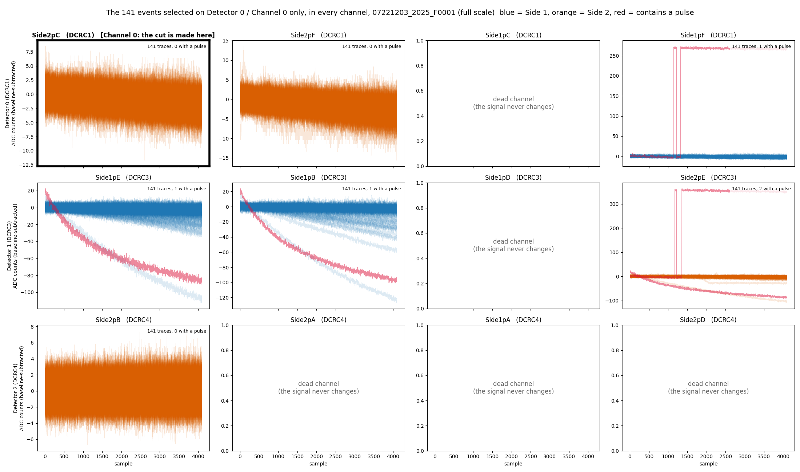
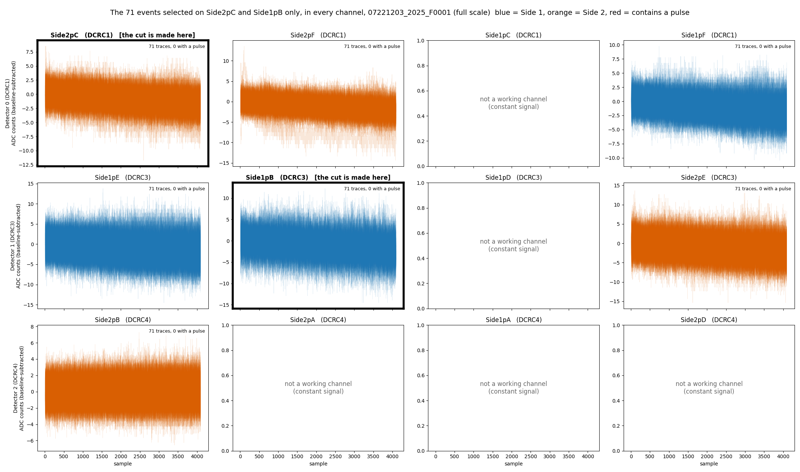
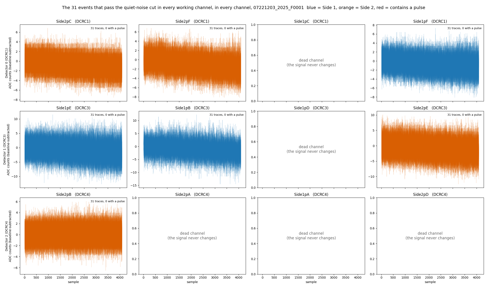
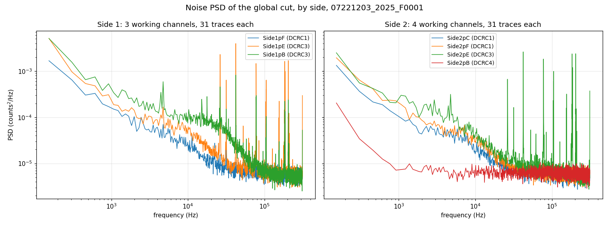
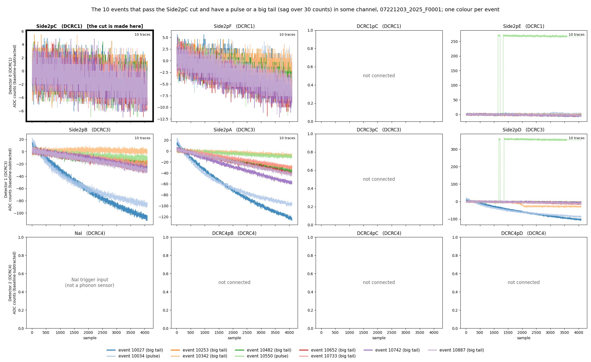
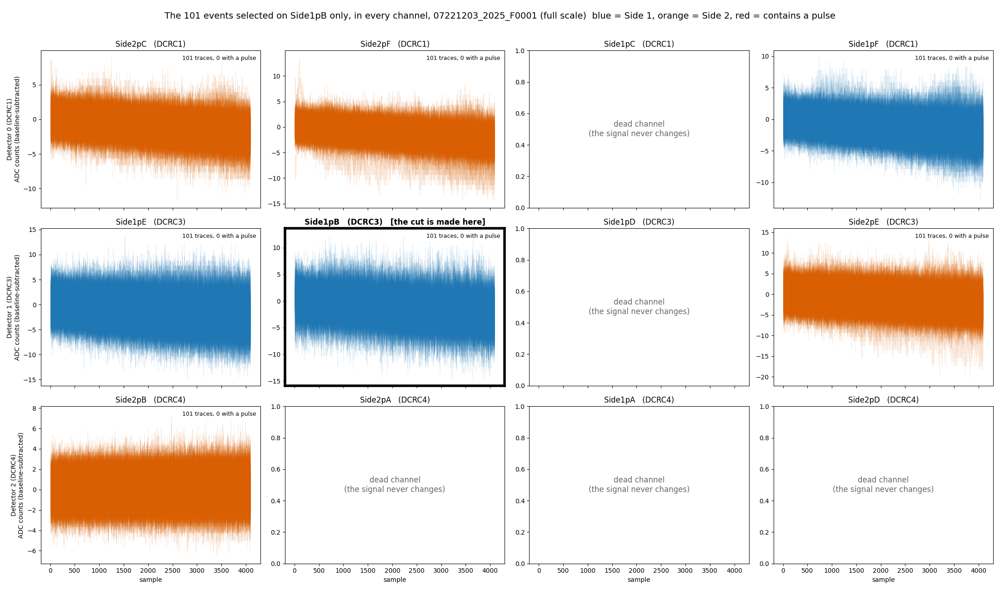

## Code repository

- [`noise-psd-randoms-buddy.ipynb`](https://github.com/villano-lab/NSDF-Data/blob/fb4df33/data_analysis/R76/student/buddy/noise-psd-randoms-buddy.ipynb) — the notebook for everything below. Pinned to `fb4df33`: the link shows the notebook as it was at that commit, which may be older than the latest version, and the file may have moved since (see `data_analysis/README.md`).

## Data and setup

We are using the file 07221203_2025_F0001, which is series 07221203_2025, Dump 1. The first 1000 events are ``random'' triggers (the ``Beginning of Run Randoms'', taken at about 20 Hz: 1000 events in 49 seconds); random triggers are snapshots of our detector traces taken at any time (rather than when a pulse occurs) to sample the noise environment. The line in the third code block of the `noise-psd-randoms-buddy.ipynb` notebook shows the randoms cut defined as `quiet_noise = pc.excursion_band(pulses, config_500) & (np.log10(bstd_500) < 0.5)` in addition to selecting the trigger specification for random events. The other 8 of the 1008 events that carry the randoms label are ``in-run'' randoms: they are spread through the rest of the dump, about one per second (8 in the last 9 seconds; the timestamps have one-second resolution). The run configuration of series `07220916_2200` lists 5 Hz for in-run randoms, which does not match what we see here, so that rate should not be assumed for this series. 

::: callout
**Note.** The trigger specifications have the wrong wording (see [Note 2a](https://villano-lab.github.io/NSDF-Data/notes/note-02a-bstd-vs-time.html#randoms))
:::

It may also be useful to have a diagram of the detector and which channels are working during the R76 run period at UMN. The figure below was reconstructed from the archive of the [UMN Wiki](https://villano-lab.github.io/R76Analysis/index.html). 

**How we found which channel is which.** The data are numbered by detector (0 to 2) and channel (0 to 3), but there is one detector, S104, read out by three four-channel electronics boards (DCRC1, DCRC3, DCRC4). We matched them to the detector's channels in four steps:

1. **The channel table.** The *Setup* table of the [UMN Run 76 summary](https://villano-lab.github.io/R76Analysis/cdms/k100/run_summary/run_76.html) lists the 12 channels by board, with the detector channel in its Label column (`Side1pA` to `Side2pF`). We used that column. The HV columns repeat entries and look like typos.
2. **The board order.** The table does not say which board is detector 0, 1 or 2. The raw file of another Run 76 series (`07220916_2200`; the raw file for our series is not on NSDF) holds the run configuration. It enables boards DCRC1, DCRC3 and DCRC4, and the three records of each event carry the codes 9, 11 and 12, which are the board numbers plus 8. So detector 0, 1, 2 = DCRC1, DCRC3, DCRC4. This is inferred and not confirmed.
3. **The channels within a board.** We assumed they follow the table's row order. The data agree: the dead channels, whose signal never changes (channel 2 of DCRC1 and DCRC3, and channels 1 to 3 of DCRC4) are the ones that configuration lists with zero QET bias.
4. **The faces.** The wiki's source-position figure draws Side 2 as seen after flipping the detector over, which is how the figure below shows it.

The mapping is kept in [`python/pulse_channels.py`](https://github.com/villano-lab/NSDF-Data/blob/fb4df33/python/pulse_channels.py), marked as under development, and section 7 of the notebook gives the evidence.


**Figure 1: The channels of detector S104.** Side 1 is on the left and Side 2 on the right (as seen after flipping the detector over). The 7 working channels are coloured; the 5 dead channels (whose signal never changes) are grey and hatched.

## The question

Based on this series' "Beginning of Run Randoms (BORR)," what is our best estimate for the noise environment of the experimental setup? The noise environment is typically summarized in terms of the Power Spectral Density (PSD).

## Selection of Randoms in All Channels

Typically, BORR are taken in the first events of the first "dump" (file) of a series' raw data. In this series that is the case and there are 1000 BORR. Often many of the initial traces are "contaminated" with a real physics pulse that just happened to be in the random's readout window. We call this a "pileup" pulse. Those occurances can mess up the noise computation and therefore the Optimal Filter amplitudes. Here I describe how we make a cut on the data to be sure those pileups are removed. 

This sort of thing has been done on one channel, Detector 0 / Channel 0, and it is the topic of [Note 2](https://villano-lab.github.io/NSDF-Data/notes/note-02-noise-selection.html) and [Note 2a](https://villano-lab.github.io/NSDF-Data/notes/note-02a-bstd-vs-time.html). Note 2 develops the noise-pulse selection: an excursion cut on a 500-sample pretrigger window (the Tight band) together with a cut on the baseline scatter, `log10(bstd) < 0.5`, which keeps 179 of the 1517 traces. Note 2a adds the trigger cut that keeps only the randoms, 141 of those 179 (the other 38 are real triggers), and looks at how the baseline scatter changes with time. 

To use that cut I have to decide how to apply it to all of the channels. A pileup should show up in all channels simultaneously, because the origin is a real physics event. It is possible the amplitude in some channels could be small enough so that it's not obvious. Figure 2 is a plot based on the cut for PCS2 only (see the [Data and setup](#data-and-setup) section). To my slight surprise I found that this cut *does not remove* some traces that are either glitches or tails of pulses on Side 1. I don't want those pulses in the noise sample. 




**Figure 2: The 141 randoms that pass the Channel 0 cut, in every channel.** One tile per channel (rows are the boards DCRC1, DCRC3 and DCRC4); the traces are drawn over each other with transparency, baseline-subtracted, on a free vertical scale. The cut is made on `Side2pC` (Detector 0 / Channel 0, framed). Blue is Side 1, orange is Side 2, and red marks a trace that contains a pulse. The 5 tiles with grey text are the dead channels. Several traces carry large baseline ramps in the Side 1 and DCRC3 channels even though they are quiet in `Side2pC`.

Based on what was seen in Figure 2. I developed a cut that will select noise for PBS1. It will hopefully not be as strict as requiring the analogous cut to be true on *all* channels. That leaves only 31 traces (see [Appendix A](#appendix-a-the-strictest-cut-every-working-channel)). 

Instead of doing *all* channels I selected instead one channel on each side to apply the standard cut to and then took the logical "AND." In that case the remaining number of traces was somewhat small (71) but the quality looked pristine. 



**Figure 3: The randoms that pass the cut on one channel of each side, in every channel.** The cut is the quiet-noise cut on `Side2pC` (Side 2) **and** on `Side1pB` (Side 1), both framed. One tile per channel, with the traces drawn over each other with transparency on a free vertical scale. Blue is Side 1, orange is Side 2, and red would mark a trace that contains a pulse. The 5 tiles with grey text are the dead channels.

While setting this up in the Jupyter notebook [`chan0-cut-on-all-channels-buddy.ipynb`](https://github.com/villano-lab/NSDF-Data/blob/8413311/data_analysis/R76/student/buddy/chan0-cut-on-all-channels-buddy.ipynb), I checked if there were similar traces left in S2 after selecting on PBS1, just like we saw in S1 after selecting on PCS2. [Appendix B](#appendix-b-the-cut-on-side1pb-only) shows the traces left in S1 after the PCS2 cut (Figure 6), and then the S1 cut itself (Figure 7). To my surprise there *were not* traces in S2 that were very apparent. That means that for some reason only cutting on S1 is more pure. Since only cutting on S1 is also less restrictive by definition, this led to more accepted randoms (101, compared with 71 for one channel on each side and 31 for all channels).

**We will use this cut going forward:** the cut of Notes 2 and 2a (a random trigger in the Tight excursion band with `log10(bstd) < 0.5`) made on `Side1pB` (S1, Detector 1 / Channel 1). In the notebook it is defined in one place, `clean_randoms_cut`, and the selection it makes is called `clean_randoms`.

## Noise Power Spectral Densities

The key parameter we want to get out of pulses in these detectors is the overall "amplitude" because it should be proportional to the energy deposited in a scattering event. That's hard to do for the small signals (near the noise baseline) that we have for dark matter direct detection (see the review by Schnee [1]) so we use an algorithm called the Optimal Filter (OF) (Gatti and Manfredi [2]; Golwala [3]) instead of a simpler procedure like integrating the pulses. The crucial part of the OF is that it takes into account the electronic noise environment of the sensor, rather than blindly integrating. The noise is summarized by the Power Spectral Density (PSD) constructed with traces that have no pulses present--the ones we are selecting here.

The PSD is sort of like the standard deviation of different frequency components in a trace (any trace can be written as a sum of sinusoids of different frequencies, the Fourier decomposition [4]). The PSD can be calculated for discrete data sampling as below:

Take a trace of N samples x[n], n = 0 … N−1, taken every Δt (here Δt = 1.6 µs), with its baseline subtracted. Its discrete Fourier transform is X[k], and bin k sits at the frequency f[k] = k / (N Δt). Averaging over M traces with no pulse in them (here the M = 101 traces of the `clean_randoms` cut, or the 31 of Appendix A), the one-sided PSD is

```
X[k] = sum over n of  x[n] exp(-2πi k n / N)

S[k] = (2 Δt / N) · (1/M) · sum over the M traces of |X[k]|²        (counts² / Hz)
```

where the factor 2 folds the negative frequencies onto the positive ones (it is left out for the zero-frequency and Nyquist bins), and the 1/N and Δt make S independent of the trace length and the sampling rate, so that its integral over frequency equals the variance of the trace. This is the convention used in the notebook (`noise-psd-randoms-buddy.ipynb`); Note 3 plotted the raw |X[k]|² instead, which differs from S only by the constant 2Δt/N.

### References

1. R. W. Schnee, "Introduction to dark matter experiments," in *Physics of the Large and the Small, TASI 2009* (World Scientific, 2011), [arXiv:1101.5205](https://arxiv.org/abs/1101.5205).
2. E. Gatti and P. F. Manfredi, "Processing the signals from solid-state detectors in elementary-particle physics," *Rivista del Nuovo Cimento* **9**(1), 1 (1986).
3. S. R. Golwala, *Exclusion Limits on the WIMP-Nucleon Elastic-Scattering Cross-Section from the Cryogenic Dark Matter Search*, PhD thesis, University of California, Berkeley (2000), Appendix B, "Noise and Optimal Filtering".
4. W. H. Press, S. A. Teukolsky, W. T. Vetterling and B. P. Flannery, *Numerical Recipes: The Art of Scientific Computing*, 3rd ed. (Cambridge University Press, 2007), chapters 12 and 13.

## Caveats

- **`Side2pB` (Detector 2 / Channel 0, DCRC4) may not be a normal phonon channel.** Its noise is flat and about an order of magnitude below the other working channels at low frequencies (Figure 5), and it passes the quiet-noise cut for 958 of the 1008 randoms, against 101 to 180 for the others. This could mean the channel is superconducting or otherwise not biased into its transition. The [UMN wiki](https://villano-lab.github.io/R76Analysis/cdms/k100/run_summary/run_76.html) does not say so: it never mentions superconducting channels, and its only related remark is that three channels (`pB`, `pD`, `pE`, with no side given) "had railed in the middle of the data period" in October. The run configuration we read for another series (`07220916_2200`) lists zero QET bias on all four DCRC4 channels, with the feedback of channel 0 disabled, which fits a channel that is not in transition but does not prove it. Until this is confirmed, the spectra of `Side2pB` should not be taken as a phonon noise measurement.

## Next steps

## Appendix A: the strictest cut (every working channel)

The strictest version of the selection keeps a random only if it passes the quiet-noise cut (the Tight excursion band and `log10(bstd) < 0.5`) in **every working channel**. Seven of the 12 channels work and five are dead (their signal never changes), so the cut is applied to the seven. It keeps **31 of the 1008 randoms**, far fewer than the 141 that pass on `Side2pC` alone. Each of the six working channels on DCRC1 and DCRC3 passes the cut for only 101 to 180 randoms on its own (DCRC4's `Side2pB` for 958), and the events that fail are not the same in all of them. Any two channels share 62% to 95% of the smaller set (well above the 10 to 30 events expected by chance), but each further channel removes more, so only 31 events pass in all of them, 31% of the 101 of `Side1pB`, the strictest channel. The Tight excursion band does most of the rejecting: only 116 to 189 of the 1008 randoms fall in the band on each of those six channels, while the `log10(bstd) < 0.5` condition keeps 770 to 895.

Figure 4 shows the 31 traces themselves in every channel (section 12 of `chan0-cut-on-all-channels-buddy.ipynb`): none of them has a pulse or a ramp, and they all look like noise, but there are only 31 of them. Figure 5 shows their noise power spectra, the mean of the 31 traces in each channel (section 11 of `noise-psd-randoms-buddy.ipynb`). With so few traces the spectra are jagged from bin to bin, and no spread between the traces is drawn. This is why a cut that is not required to hold on all channels, and so keeps more traces, is worth looking for.



**Figure 4: The 31 randoms that pass the quiet-noise cut in every working channel, in every channel.** One tile per channel (rows are the boards DCRC1, DCRC3 and DCRC4), with the traces drawn over each other with transparency, baseline-subtracted, on a free vertical scale. Blue is Side 1 and orange is Side 2; no trace contains a pulse. The 5 tiles with grey text are the dead channels.



**Figure 5: Noise spectra of the 31 randoms that pass the quiet-noise cut in every working channel, by side.** Side 1 on the left (3 working channels) and Side 2 on the right (4 working channels), one colour per channel within each panel (the colours are not shared between the panels). Each curve is the one-sided PSD (counts$^2$/Hz), computed as the mean over the 31 traces of the squared Fourier amplitude of each trace (baseline-subtracted, first samples skipped) scaled to a one-sided density; the spread between traces is not drawn. Both panels share the same axes. The five dead channels are not shown.

## Appendix B: the cut on `Side2pC` and the cut on `Side1pB`

**What the `Side2pC` cut lets through.** Of the 141 randoms that pass the cut on `Side2pC` (Detector 0 / Channel 0), 10 have a pulse or a big tail in some channel: 2 contain a pulse and 8 more have a baseline sag of more than 30 counts across the trace. Figure 6 shows only these 10, each in its own colour, which is the same in every tile. Event 10550 (light green) has a step of about 270 counts in `Side1pF` and 360 counts in `Side2pE` at about sample 1150, with a brief return towards zero before it steps up again. Event 10034 (light blue) is a long decay in the three DCRC3 channels, down to about -100 counts. The big tails are in DCRC3, and the sag is largest in `Side1pB` for 8 of the 10 events (up to 133 counts for event 10027). In the framed `Side2pC` tile, and in `Side2pB` on DCRC4, the same 10 traces lie in the same noise band as all the others, which is why the `Side2pC` cut cannot see them.



**Figure 6: The 10 randoms that pass the `Side2pC` cut but have a pulse or a big tail in some channel.** They are drawn in every channel, but the tails are in a few of them (mainly the three DCRC3 channels, on both sides); the other channels show only noise. The cut is made on `Side2pC` (framed). One colour per event, the same in every tile, and the legend gives the event numbers and whether each has a pulse or a big tail (a sag of more than 30 counts across the trace). One tile per channel (rows are the boards DCRC1, DCRC3 and DCRC4), baseline-subtracted, on a free vertical scale. The 5 tiles with grey text are the dead channels.

**The cut on `Side1pB` only.** The cut we will use is the one of Notes 2 and 2a on `Side1pB` alone: a random whose trace passes the Tight excursion band and `log10(bstd) < 0.5` on that channel. It keeps **101 of the 1008 randoms**, more than the 71 of the cut on one channel of each side and the 31 of the cut on all channels, but fewer than the 141 of the `Side2pC` cut. There is nothing in it that is not noise: none of the 101 events contains a pulse in any working channel, and the largest baseline sag in a Side 2 channel is 13 counts, where a sag of more than 30 counts counts as a big tail (section 10 of the notebook). Figure 7 shows the 101 events in every channel at full scale.



**Figure 7: The 101 randoms that pass the cut on `Side1pB`, in every channel, at full scale.** The cut is made on `Side1pB` (framed). One tile per channel, with the traces drawn over each other with transparency, baseline-subtracted. Blue is Side 1 and orange is Side 2; no trace contains a pulse. The 5 tiles with grey text are the dead channels.
