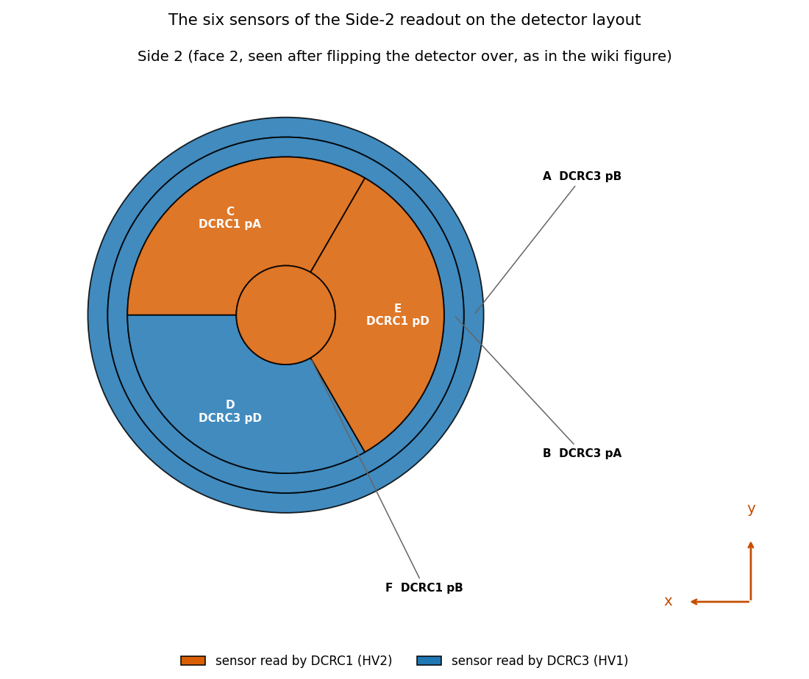
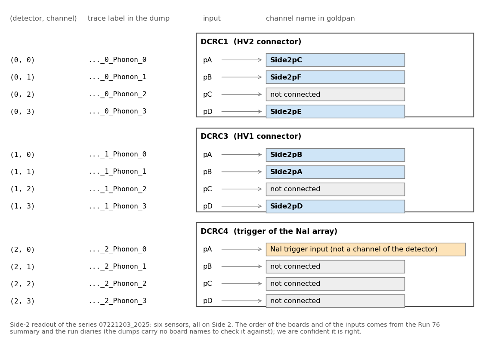
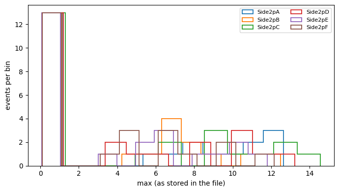
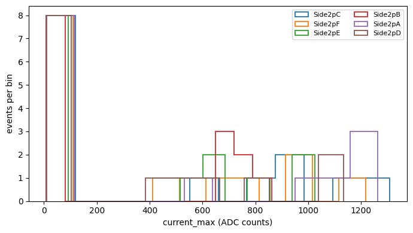
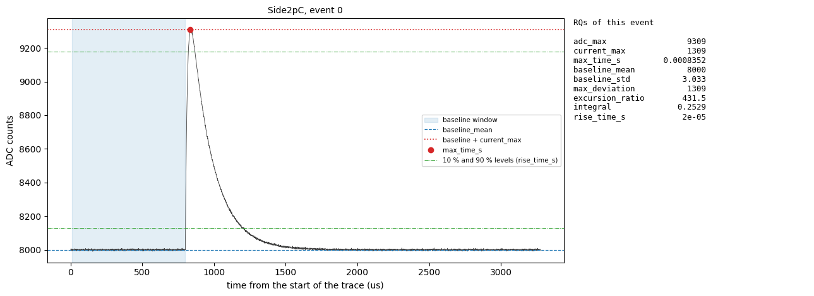
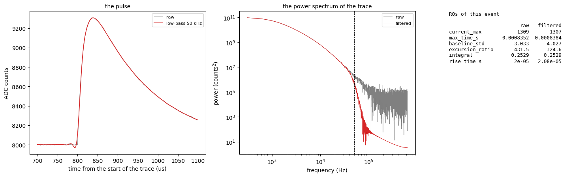

<!-- The clickable outline at the top of the published page is built from the ## headings below: do not write one. -->

## Code repository

The code is in the [`NSDF-Data`](https://github.com/villano-lab/NSDF-Data) repository: `python/` is `goldpan`, `goldsluice/` is `goldsluice`, `registry/` is the detector registry ([Appendix A](#appendix-a-the-detector-registry)), and the notebooks are in `data_analysis/R76/notebooks/goldpan-goldsluice/`. The notebooks of the section *Examples* run on made-up data saved next to them, so they work on a fresh clone:

- [`example-1-read-rqs-and-plot.ipynb`](https://github.com/villano-lab/NSDF-Data/blob/3216890ab10f27a3085a048b7b826ecc6ffaff4f/data_analysis/R76/notebooks/goldpan-goldsluice/example-1-read-rqs-and-plot.ipynb): read RQ files (ROOT) and plot one quantity.
- [`example-2-read-processed-quantities-and-plot.ipynb`](https://github.com/villano-lab/NSDF-Data/blob/729c10eb4de82929d04275757edab15f6eebfde1/data_analysis/R76/notebooks/goldpan-goldsluice/example-2-read-processed-quantities-and-plot.ipynb): read the Parquet quantities of a `goldsluice` run and plot one.
- [`example-3-trace-and-its-rqs.ipynb`](https://github.com/villano-lab/NSDF-Data/blob/1f4841f236d8938215ecd8530b32647d87d5243e/data_analysis/R76/notebooks/goldpan-goldsluice/example-3-trace-and-its-rqs.ipynb): a trace next to its quantities, computed with `goldsluice.run`, and the same after a low-pass filter.
- [`example-4-trace-and-its-processed-rqs.ipynb`](https://github.com/villano-lab/NSDF-Data/blob/33d8aab57abcdc12af0c86237e128e99b1439718/data_analysis/R76/notebooks/goldpan-goldsluice/example-4-trace-and-its-processed-rqs.ipynb): a trace next to its processed quantities, both read from disk with `ds.read()`.

Notebooks on the real Run 76 series `07221203_2025`; the processed files they read are the output of `python -m goldsluice run` in `goldsluice/examples/` (in `~/goldsluice-output/`) and are not in the repository:

- [`rq-histogram-goldpan.ipynb`](https://github.com/villano-lab/NSDF-Data/blob/22f308d7590971578a25c9051da242d9a7b8057d/data_analysis/R76/notebooks/goldpan-goldsluice/rq-histogram-goldpan.ipynb): reads the RQs from ROOT files, histograms one, and plots the RQs over the pulses (on synthetic files saved next to it, no raw data needed).
- [`goldsluice-processed-plots.ipynb`](https://github.com/villano-lab/NSDF-Data/blob/22f308d7590971578a25c9051da242d9a7b8057d/data_analysis/R76/notebooks/goldpan-goldsluice/goldsluice-processed-plots.ipynb): the Parquet dataset of the first `goldsluice` run (30 dumps, 81,992 events, six phonon channels): distributions, correlations between channels, and the trend from dump to dump.
- [`goldsluice-root-rqs.ipynb`](https://github.com/villano-lab/NSDF-Data/blob/6000af9835e48009074a238c383f9dff0be43feb/data_analysis/R76/notebooks/goldpan-goldsluice/goldsluice-root-rqs.ipynb): the same run written as ROOT files in the layout of the collaboration's RQ files, with the structure of the files drawn.
- [`goldsluice-all-rqs-plots.ipynb`](https://github.com/villano-lab/NSDF-Data/blob/fb44c2c19c1570b7991020c7507fa269373bbedb/data_analysis/R76/notebooks/goldpan-goldsluice/goldsluice-all-rqs-plots.ipynb): all nine quantities of the six-algorithm run, for the six channels.

The links are pinned to the commit that produced each notebook: they show it as it was then, which may be older than the latest version, and the files may have moved since (see `data_analysis/README.md`).

## Data and setup

**Setup.** Follow the [setup guide](https://villano-lab.github.io/NSDF-Data/students/setup.html) and the [first-analysis guide](https://villano-lab.github.io/NSDF-Data/students/first-analysis.html). `pip install -r requirements.txt` installs `goldpan`, but not `goldsluice`: its kernels are written in Rust and you build it yourself. Install Rust (on Windows also the Visual Studio *Build Tools* with "Desktop development with C++") and then, in the `goldsluice/` folder of the repository, run `python -m pip install maturin` and `maturin develop --release` (see `goldsluice/README.md`). You need `goldsluice` to run the processing (the section *Processing the downloaded data*) and for Example 3; everything that only reads files, which is all the other sections and examples, needs `goldpan` alone.

**The datasets of this note.** One real series, `07221203_2025`, and what is made from it, and some made-up data that is saved in the repository so that the examples run on a fresh clone:

| dataset | what it is | where | used in |
|---|---|---|---|
| Run 76 raw dumps | the series `07221203_2025` of Run 76: 30 dumps (idx format), 81,992 events, 1.9 GB; Side-2 readout, detector `NAI-S2`, six phonon channels `Side2pA` to `Side2pF` | `~/idx/07221203_2025_F0001` to `_F0030`, downloaded from NSDF (below) | [Reading data and doing a simple analysis](#reading-data-and-doing-a-simple-analysis-with-goldpan), [Processing the downloaded data](#processing-the-downloaded-data-with-goldsluice-and-reading-it-back-in-goldpan) |
| `goldsluice` quantities, Parquet | the quantities that `goldsluice` made from the raw dumps (30 files, nine per channel); not in the repository | `~/goldsluice-output/r76-07221203/NAI-S2/`, made by `python -m goldsluice run r76-registry.dataset.toml` in `goldsluice/examples/` | [Processing the downloaded data](#processing-the-downloaded-data-with-goldsluice-and-reading-it-back-in-goldpan), [Example 2](#example-2-i-have-the-parquet-quantities-of-a-goldsluice-run-and-want-a-plot) |
| `goldsluice` quantities, ROOT RQ files | the same series written as ROOT files in the layout of the collaboration's RQ files, from an earlier run with two algorithms (`peak` and `max_time`, three quantities per channel); not in the repository | `~/goldsluice-output/r76-07221203/` | [Cached reading of the quantities](#cached-reading-of-the-quantities-under-development) |
| synthetic RQ files (ROOT) | two small files, 24 made-up events | `data_analysis/R76/notebooks/goldpan-goldsluice/synthetic-rq/` | [Example 1](#example-1-i-have-rq-files-and-want-a-plot) |
| synthetic traces (`goldpan` Parquet) | the traces of 14 made-up events, six sensors, 4096 samples | `.../synthetic-goldpan/` | [Example 3](#example-3-i-have-a-raw-trace-and-want-to-see-it-next-to-its-rqs), [Example 4](#example-4-i-have-the-traces-and-their-processed-quantities-on-disk-and-want-them-side-by-side) |
| synthetic quantities (Parquet) | what `goldsluice` made from the synthetic traces, with the definition file `synthetic.dataset.toml` that names both | `.../synthetic-quantities/` | [Example 2](#example-2-i-have-the-parquet-quantities-of-a-goldsluice-run-and-want-a-plot), [Example 4](#example-4-i-have-the-traces-and-their-processed-quantities-on-disk-and-want-them-side-by-side) |

**Getting the raw data.** The raw dumps are not in the repository; they are fetched from the NSDF servers with `nsdf-cli`. Go to your home folder first: the download makes an `idx` folder in the folder you are in, and it must not sit inside `NSDF-Data`.

```
cd ~
nsdf-cli download 07221203_2025_F0001
```

That is one dump (about 34 MB), enough for the first section. The whole series, 30 dumps and about 1.9 GB, is

```
nsdf-cli download 07221203_2025 --all
```

and `nsdf-cli config --output-global ~/idx` makes every later download go to `~/idx` whichever folder you are in. Both guides above say more.

**The quantities.** Which series, dump, detector and channel is used is stated where it is used. The quantities are the outputs of the algorithms of `goldsluice`: `python -m goldsluice algorithms` lists them, and Example 3 shows what each one measures on a trace.

## The question

What are the packages `goldpan` and `goldsluice`? These are data analysis programs that are made to analyze processed data and to process pulse data respectively. `goldsluice` might take in some raw pulses and integrate them, saving the values of the integrals into a file. Those values are sometimes called Reduced Quantities (RQs) and they are in turn analyzed and/or manipulated with `goldpan` to get science results. Any generic function for fetching or manipulating data would go in these programs, rather than sitting in multiple people's analysis codes. The names were chosen with the help of AI because we want to discover something valuable in the data, one program takes a huge chunk of raw data and makes it manageable (`goldsluice`) and one sifts through very carefully for the key science (`goldpan`). 

## Reading data and doing a simple analysis with `goldpan`

A *dataset definition file* tells `goldpan` where the data are and how to read them: the source (the raw files, their format and the detector they came from), and, through the detector registry, the readout of that detector (sample period, trigger position, channel names). Nothing about the electronics is assumed in the code. `Dataset.open` reads the file; no data are read until we ask for them.

The file used here is `goldsluice/examples/r76-registry.dataset.toml`.

<details>
<summary>The dataset definition file, to copy into a file of your own</summary>

A copy as of this note (the `registry` and `glob` paths and the output folder are the ones to change):

```toml
# The same dataset as r76.dataset.toml, with the detector described in the registry (../../registry) instead of in this file:
# the readout, the channel map and the roles come from the record of "NAI-S2", and root_detector from its `number`.
# Everything written here wins over the registry, key by key. `python -m goldsluice check r76-registry.dataset.toml` lists the files.

[dataset]
name = "r76-07221203"
output = "~/goldsluice-output/r76-07221203"
registry = ["../../registry"]                  # folders of detector records, relative to this file (goldpan.registry); also GOLDPAN_REGISTRY
# output_format = "root"                       # for ROOT output the zip<N> number is the record's `number`: no root_detector needed

[[sources]]
name = "side2"
format = "idx"
glob = "~/idx/07221203_2025_F*"
detector = "NAI-S2"                            # in the registry: it supplies readout = "DCRC_RUN76" and the idx channels and roles

[[processing]]
algorithm = "peak"
channels = "role:phonon"
[processing.params]
glitch_samples = "@readout.glitch_samples"
pretrigger_samples = "@readout.pretrigger_samples"
amps_per_adc = 1.0                             # PLACEHOLDER: current_max is in ADC counts until the ADC-to-amps scale is known

[[processing]]
algorithm = "max_time"
channels = "role:phonon"
[processing.params]
sample_period_s = "@readout.sample_period_s"
```

</details>

```python
from goldpan.dataset import Dataset

ds = Dataset.open("goldsluice/examples/r76-registry.dataset.toml")
ev = next(ds.iter_events(processed=False))     # the pulses of the first raw dump, as one Events
```

<details>
<summary>What does <code>next(ds.iter_events(processed=False))</code> do?</summary>

`ds.iter_events(...)` returns a generator. It goes through the raw files of the dataset's source one at a time (30 here), reads each with the adapter for its format (`idx`) and gives back an `Events` with the pulses, the event keys (`series`, `dump`, `event`) and the trigger type. Nothing is read until the next item is asked for.

- `processed=False` says that only the pulses are wanted. The default, `True`, also reads the processed quantities from the `goldsluice` output and attaches them to each event, and fails if the batch run did not cover the file.
- `next(...)` advances the generator once, so only the first file (`07221203_2025_F0001`) is read. A loop `for ev in ds.iter_events(...)` would read all 30 files, one after the other, and never hold more than one in memory.

</details>

The lines `registry = [...]` and `detector = "NAI-S2"` hand the description of the detector (its channels, their roles and the readout) to the registry, which is explained, with a copy of its files, in [Appendix A](#appendix-a-the-detector-registry).

For the Run 76 series `07221203_2025` this is the first of 30 raw files, 1,517 events and six phonon channels (`Side2pA` to `Side2pF`). `ev.trace("Side2pC")` is an array with one row per event and one column per sample (4096 samples of 0.8 us). The traces are the raw ADC values: they are **not** baseline-subtracted, and sit at about 3,200 counts for this channel. A simple analysis is to subtract each event's own baseline, take the largest value above it and histogram that over the events, or to overlay the largest pulses against `ev.time_axis()`. `goldpan.operations.baseline_subtract` does the subtraction: it takes each event's mean over the samples before the trigger (`cfg.pretrigger_samples`, here 500), leaving out the first ten, which can carry an electronics glitch.

The channel names say where a trace comes from. A name such as `Side2pC` is the sensor `pC` on Side 2 of the detector; Figure 1, the figure of Note 9, shows where the six sensors are on the detector.



**Figure 1: The six sensors of detector S104 on Side 2**, the face that is read out in this series (as seen after flipping the detector over; figure of Note 9). Each region is coloured by its readout board, DCRC1 (orange) or DCRC3 (blue), and labelled with its letter, its board and input.

<details>
<summary>How do the dump's trace labels become channel names, and where is that defined?</summary>

The raw dump labels a trace only by two small integers, `<event>_<detector>_Phonon_<n>`. In Run 76 the three "detectors" 0, 1 and 2 are not detectors but three four-input readout boards (DCRC1, DCRC3 and DCRC4) of one detector, and `n` is the input of the board, `pA` to `pD`. Figure 2 shows how the dump's labels map to the channel names. Only six of the twelve inputs are sensors, one is the trigger signal of the NaI array and five are not connected, so `goldpan` has six channels for this series.



**Figure 2: From the dump's trace labels to the channel names of the Side-2 readout.** Each box is a readout board and each row one of its four inputs. The blue rows are the six sensors, `Side2pA` to `Side2pF`. The orange row is the input of the NaI array's trigger signal, which is not a channel of the detector, and the grey rows are not connected (their signal never changes). The order of the boards and of the inputs comes from the Run 76 summary and the run diaries. The dumps carry no board names to check it against, so the registry marks it `inferred`, but we are confident it is right.

The names are defined in the registry, in `registry/run76.toml` (Appendix A), as a pair `[detector, channel]` for each name: `Side2pC = [0, 0]` is channel 0 of detector 0. A dataset definition picks that up with `detector = "NAI-S2"`, and a `channels` table written in the definition file itself wins over the registry. `goldpan.channels` holds a second copy of the same map, from the setup table of the Run 76 summary; it is marked under development, and a test checks that the registry agrees with it.

</details>

```python
from goldpan import operations

cfg = ev.detector.readout.segments[0].config           # the readout: sample period, trigger sample, glitch samples
trace = ev.trace("Side2pC")                            # raw ADC counts, (events, samples)
pulse = operations.baseline_subtract(trace, cfg)       # each event minus its own mean before the trigger
peak = pulse[:, cfg.glitch_samples:].max(axis=1)       # the largest value above the baseline, per event
```

In the first dump the median peak of `Side2pC` is 6 ADC counts and the largest is 411. **Reading the traces is the slow part, and it is not cached.** `iter_events` reads the raw dump from disk every time you call it: about 3 seconds for this one dump. Only the processed quantities are cached (see below). So read the traces of one dump to look at pulses, and leave the pass over all the data to `goldsluice`. The cost is per dump: the raw reader cannot fetch single traces from the file, so looking at a few events still reads their whole dump (about 3 seconds). Afterwards you can keep just those events, by position or by event number:

```python
ev.select([12, 345])                                   # the events at positions 12 and 345 of this dump
few = ev.select(ev.quantities["event"].to_numpy() == 10003)    # the event with number 10003 (event numbers restart in every dump)
few.trace("Side2pC")                                   # (events kept, samples)
```

<details>
<summary>Why not read all the dumps at once with <code>ds.read()</code>?</summary>

`ds.read()` reads every file of the source and joins them into one `Events`, so everything is in memory at once. For all 30 dumps that is 82,000 events with six 4096-sample traces each, read from disk again every time, with no caching. `iter_events` gives the same data one file at a time, so a loop over it can compute what it needs from each dump and let it go.

</details>

## Processing the downloaded data with `goldsluice` and reading it back in `goldpan`

`goldsluice` reads the same dataset definition file, runs its `[[processing]]` steps over every raw dump and writes the results outside the repository (e.g. `~/goldsluice-output/`). Here the steps are `peak` (the largest value above the baseline, `current_max`, and the largest ADC value, `adc_max`) and `max_time` (the time of that maximum, `max_time_s`), on the six phonon channels. It is run from a terminal, in `goldsluice/examples/`; reading the raw dumps takes a couple of minutes and is most of the time.

```
python -m goldsluice check r76-registry.dataset.toml    # lists the raw files and the steps, reads nothing
python -m goldsluice run r76-registry.dataset.toml      # processes every dump
```

The output is a `goldpan` Parquet dataset, one file per dump (`output_format = "root"` in the definition gives ROOT files in the layout of the SuperCDMS collaboration's RQ files instead). Reading it back needs no raw data:

```python
q = ds.processed()                          # the processed quantities of all dumps, no pulses: small and fast
q.quantities["Side2pC"]["current_max"]      # a record per channel, a field per quantity
```

This is 81,992 events with three quantities for each of the six channels. `current_max` is still in ADC counts because the conversion to amps (`amps_per_adc`) is a placeholder equal to 1 until the scale is known. For the RQ-file layout there is a cached reader, `goldpan.rqdata.load`, described in the next section.

## Cached reading of the quantities (under development)

There is a second way to read the quantities, `goldpan.rqdata.load`, which reads RQ files (the format of the collaboration's processed files) as numpy arrays and keeps what it read in a cache, `~/.cache/goldpan/rqdata`. `goldsluice` can write its quantities as such files (`output_format = "root"` in the definition), or `goldpan.adapters.rq_root.write` can write the Parquet quantities of the previous section as RQ files, one per dump with a branch `<channel>_<quantity>` for each. The quantities are chosen with patterns, where `P*` stands for the six sensors (it is only a shorthand in the request, not part of a branch name). The files of the run so far (`peak` and `max_time`) have these 18 branches in the tree `rqDir/zip1`, and `rqDir/eventTree` has `SeriesNumber`, `DumpNumber` and `EventNumber`:

| channel | `adc_max` | `current_max` | `max_time_s` |
|---|---|---|---|
| Side2pA | `Side2pA_adc_max` | `Side2pA_current_max` | `Side2pA_max_time_s` |
| Side2pB | `Side2pB_adc_max` | `Side2pB_current_max` | `Side2pB_max_time_s` |
| Side2pC | `Side2pC_adc_max` | `Side2pC_current_max` | `Side2pC_max_time_s` |
| Side2pD | `Side2pD_adc_max` | `Side2pD_current_max` | `Side2pD_max_time_s` |
| Side2pE | `Side2pE_adc_max` | `Side2pE_current_max` | `Side2pE_max_time_s` |
| Side2pF | `Side2pF_adc_max` | `Side2pF_current_max` | `Side2pF_max_time_s` |

A request is a list of such patterns:

```python
from goldpan import rqdata

RQS = ["P*_adc_max", "P*_current_max", "P*_max_time_s"]
where = dict(detector=N, files=str(RQ_DIR / "{series}_F*.root"), phonon_channels=sensors, all_files=True)

data = rqdata.load("07221203_2025", RQS, **where)     # first time: reads the 30 files
data = rqdata.load("07221203_2025", RQS, **where)     # second time: from the cache
data["Side2pA_current_max"]                           # a numpy array, one number per event
```

For the 30 files (81,992 events, 18 branches) the first read took 4.0 seconds and the second 0.1 seconds. Asking for fewer quantities than a cached read has (`["P*_current_max"]`) is also served from the cache, and a file that is rewritten is read again, never served stale. `rqdata.cache_info()` lists the entries (here 2 entries, 37 MB) and `rqdata.cache_clear()` removes them.

This is not the same reader as `Dataset` and `ds.processed()`: it returns flat arrays and not an `Events`, it takes patterns for the quantities, which the other reader does not, and it reads ROOT files only (the Parquet quantities are read by `ds.processed()`, which has no cache, so no reader at the moment both reads Parquet and caches). Whether there should be two ways of reading, and where the cache belongs, is an open question for the development ([issue 177](https://github.com/villano-lab/NSDF-Data/issues/177)). The raw traces are not cached by either.

## Examples

Each example is a short notebook with one goal, and runs on a fresh clone. The links are pinned to the commit that produced them, so they show the notebooks as they were then; the file may have moved or changed since (see `data_analysis/README.md`).

### Example 1: I have RQ files and want a plot

You have RQ files, the reduced quantities of a series with one ROOT file per dump, and how they were made does not matter. [`example-1-read-rqs-and-plot.ipynb`](https://github.com/villano-lab/NSDF-Data/blob/3216890ab10f27a3085a048b7b826ecc6ffaff4f/data_analysis/R76/notebooks/goldpan-goldsluice/example-1-read-rqs-and-plot.ipynb) reads them with `goldpan.adapters.rq_root.read`, prints the names of the fields, and histograms one quantity for all six channels. It uses the small synthetic files saved next to it; for your own files you change the folder and the detector number in one cell.



**Figure 3: The distribution of the RQ `max` for the six channels**, from the notebook of Example 1. The data are the 24 made-up events of the synthetic files, so the shape means nothing: 13 events have no pulse (a value near 0) in every channel and the rest are spread between 3 and 15. With real files the same cell draws the distribution of a real quantity.

### Example 2: I have the Parquet quantities of a `goldsluice` run and want a plot

`goldsluice` has processed some pulses and written the quantities as a `goldpan` Parquet dataset. [`example-2-read-processed-quantities-and-plot.ipynb`](https://github.com/villano-lab/NSDF-Data/blob/729c10eb4de82929d04275757edab15f6eebfde1/data_analysis/R76/notebooks/goldpan-goldsluice/example-2-read-processed-quantities-and-plot.ipynb) opens the dataset definition file with `Dataset.open`, reads the quantities with `ds.processed()` and histograms one of them for the six channels. The folder `synthetic-quantities/` next to it has the definition file and the quantities that came out of it (made-up traces, 14 events, all six algorithms), so it runs on a fresh clone; for your own run you point it at your definition file.



**Figure 4: The distribution of the quantity `current_max` for the six channels**, from the notebook of Example 2. The data are the 14 made-up events of the synthetic traces, so the shape means nothing: 8 events have no pulse in every channel and the rest have pulses of 400 to 1,300 ADC counts.

### Example 3: I have a raw trace and want to see it next to its RQs

The quantities are short descriptions of a trace, so the natural check is to draw the trace and mark what they say on it. [`example-3-trace-and-its-rqs.ipynb`](https://github.com/villano-lab/NSDF-Data/blob/1f4841f236d8938215ecd8530b32647d87d5243e/data_analysis/R76/notebooks/goldpan-goldsluice/example-3-trace-and-its-rqs.ipynb) reads the traces with `adapters.read`, computes the quantities of one channel on the spot with `goldsluice.run` (one call for each of the six algorithms, with the pretrigger window and the sample period taken from the data's readout), and draws the trace of the event with the largest pulse next to a table of its quantities. Nothing is read from a processed file. It uses the made-up traces in `synthetic-goldpan/`; a raw dump is read the same way.



**Figure 5: A trace and its quantities.** The channel `Side2pC` of the event with the largest pulse in the synthetic dump (made-up data). Left: the trace, the baseline window (shaded), `baseline_mean` (dashed), the level `baseline_mean + current_max` (dotted), the sample at `max_time_s` (dot) and the 10 % and 90 % levels between which `rise_time_s` is measured (thin lines). Right: the nine quantities of the event.

The notebook goes on to the case where the pulses are filtered before the quantities are taken. `goldpan.algorithms.lowpass` is a zero-phase low-pass filter (the pulse is not shifted in time), and `goldpan.quantities.power_spectrum` with `frequencies_hz` gives the spectrum. The same six algorithms are run on the raw and on the filtered traces (`goldsluice.run` only needs an array of shape (events, samples)), so the quantities can be compared.



**Figure 6: The same pulse before and after a 50 kHz low-pass** (made-up data). Left: the pulse, raw and filtered. Middle: the power spectrum of the baseline-subtracted trace; everything above the dashed line is cut. Right: the quantities of the event. The pulse height, its time and its integral hardly change. Away from the pulse the noise of the trace falls from 3.0 to 0.8 counts, but `baseline_std` over the baseline window goes up (3.0 to 4.0): a zero-phase filter spreads the sharp rise backward in time, into the end of the window. Whether and how to filter is part of the definition of a quantity.

### Example 4: I have the traces and their processed quantities on disk, and want them side by side

The same picture as Example 3, when `goldsluice` has already processed the pulses and written the quantities. [`example-4-trace-and-its-processed-rqs.ipynb`](https://github.com/villano-lab/NSDF-Data/blob/33d8aab57abcdc12af0c86237e128e99b1439718/data_analysis/R76/notebooks/goldpan-goldsluice/example-4-trace-and-its-processed-rqs.ipynb) opens the definition file and calls `ds.read()`, which reads the traces and the processed quantities of the same events together as one `Events`; both the traces and the quantities are read from disk, and nothing is computed. The pair is `synthetic-goldpan/` and `synthetic-quantities/out/` of Examples 2 and 3. Its figure is Figure 5 again, with the same numbers, which is the check that the processed quantities are those that the algorithms give.

More examples will follow, each for one question.

## Appendix A: The detector registry

The dataset definition file above does not say how the detector is wired or how its traces are sampled. That is data about the detector, not code, so it lives in the `registry/` folder of the repository, in TOML files read by `goldpan.registry`. Nothing in `goldpan` or `goldsluice` contains it. The folder is laid out so that it can later become a repository of its own, or a database behind the same interface ([issue 150](https://github.com/villano-lab/NSDF-Data/issues/150), "Readouts, detectors and channel maps in a registry, not in code").

- A **detector** record (`run76.toml`) has the detector's name (`NAI-S2`), its number (the `N` of the `zip<N>` tree in ROOT output), the name of its readout, and, for each file format, where each named channel is wired and what role it has. For the idx dumps a channel is a pair `[board, input]`, so `Side2pC = [0, 0]` is input 0 of dump channel 0.
- A **readout** record (`readouts.toml`) has what is needed to interpret a trace: the sample period, the number of samples before the trigger that are used as the baseline (`pretrigger_samples`) and the number of samples at the start of the trace that carry a glitch (`glitch_samples`).
- Every record has a `status`, `confirmed` or `inferred`, and an `evidence` text that says where the numbers come from. A guess is never written as `confirmed`. Both records here are `inferred`: the idx dumps carry no detector name or number, so nothing can be checked against a file.
- A dataset definition names the folder with `[dataset] registry = ["../../registry"]` (relative to the definition file), or the environment variable `GOLDPAN_REGISTRY` lists folders. Anything the definition file writes itself wins over the registry, key by key. A name may be defined only once.

A copy of the two files as of this note (the repository has the current ones):

`registry/run76.toml`

```toml
# The Run 76 detector (UMN, NaI array with Side-2 readout): the one the series 07221203_2025 was taken with.
# Read by goldpan.registry (`registry = ["../registry"]` in a dataset definition file). Not part of the library.
format_version = 1

[detectors."NAI-S2"]
number = 1                         # the N of zip<N> in ROOT output: OUR choice for this detector; it is in no raw file (issue 150)
readout = "DCRC_RUN76"             # see readouts.toml: 0.8 us per sample, 500-sample pretrigger window, 10 glitch samples
status = "inferred"
evidence = """The six sensors and their board inputs come from the Setup table of the Run 76 summary (Side-2 readout); that dump \
detectors 0, 1, 2 are DCRC1, DCRC3, DCRC4 (ascending board number) is inferred and channels 0 to 3 = inputs pA to pD is assumed: \
see goldpan.channels, which holds the same map and is marked under development. The detector number is our own choice (issue 150). \
The Run 76 idx dumps carry no detector name or number, so nothing here can be checked against a file."""
description = "Run 76 NaI array, Side-2 readout; DCRC4 pA is the NaI trigger input and is not a channel of this detector."
series = ["07221203_2025"]

[detectors."NAI-S2".idx]           # defaults for [sources.read] of an idx source: channel name = [board, input]
channels = { Side2pC = [0, 0], Side2pF = [0, 1], Side2pE = [0, 3], Side2pB = [1, 0], Side2pA = [1, 1], Side2pD = [1, 3] }
roles = { Side2pC = "phonon", Side2pF = "phonon", Side2pE = "phonon", Side2pB = "phonon", Side2pA = "phonon", Side2pD = "phonon" }
```

`registry/readouts.toml`

```toml
# The readouts (how a trace is sampled and where its baseline window ends) of the data we analyse. A detector record names one
# (`readout = "..."`). Read by goldpan.registry. Not part of the library; `goldpan.config` keeps the same two numbers as presets for
# old code, and a test checks that they agree with this file.
format_version = 1

[readouts.DCRC_RUN76]
pretrigger_samples = 500           # the end of the baseline window, and the sample where the trigger-locked pulses start: see evidence
glitch_samples = 10
sample_period_s = 0.8e-6
status = "inferred"
series = ["07221203_2025"]
description = "DCRC readout of the Run 76 series (UMN, Side-2 readout): 4096 samples at 0.8 us (1.25 MHz) is a trace of 3.2768 ms."
evidence = """sample_period_s: the first-pulse analysis of the Run 76 phonon channels, see 'The sample period' in python/README.md (we used \
1.6 us until 2026-10-22, which is the Z7 value). pretrigger_samples: measured on dumps F0005, F0015 and F0025 of 07221203_2025 \
(about 8,800 events, issue 154). The 90 % of the events whose trigger_type label is 'Unknown' have their pulse start at sample \
480 to 520 (the 10 % rise point is at sample 498, p10 to p90 480 to 510) and are flat before sample 470, so the pulse starts at \
about sample 500, not at the 1000 that this entry had until 2026-10-28. With 1000, the baseline of `peak` (the mean of samples \
10 to 1000) was about half pulse and `current_max` came out at 0.52 of its value; a baseline over samples 10 to 500 gives 0.999 \
of it. Note 2 compares the two windows and uses 500. The events labelled 'Physics' have pulses at random times. The numbers are \
the same on Side2pA, B and F. glitch_samples: see goldpan.config."""

[readouts.Z7]
pretrigger_samples = 6250
glitch_samples = 10
sample_period_s = 1.6e-6
status = "inferred"
description = "The Z7 readout (SNOLAB): a 6250-sample pretrigger window (10 ms), 1.6 us per sample (625 kHz)."
evidence = """Taken from the Z7 analysis of the collaboration's scdms-analysis-tools (a fixed 10 ms pretrigger window at 1.6 us per \
sample). NOT checked against a file: the begin-of-run ODB of series 24260424_145101 (Det07) gives a pre-trigger offset of 16383 \
samples (26.2 ms) and an on-pulse length of 32768 samples (52.4 ms), which is a different number; they may be different \
configurations. Confirm before using this entry for that series (issue 150)."""
```
