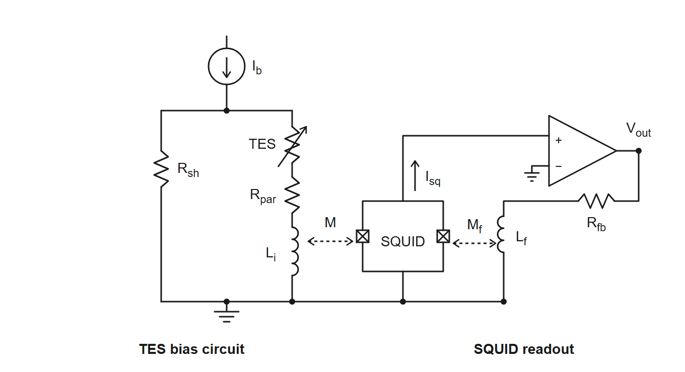
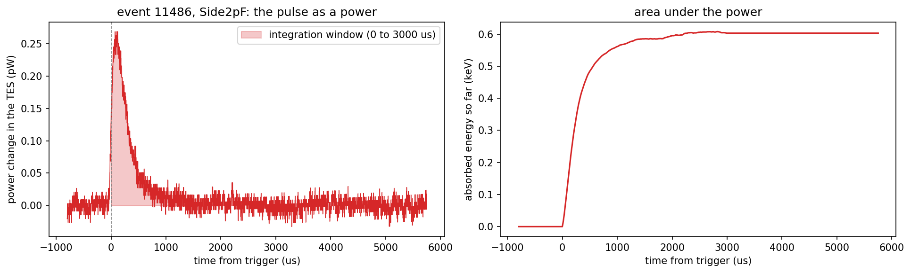

## Code repository

- [`your-notebook.ipynb`](https://github.com/villano-lab/NSDF-Data/blob/COMMIT/data_analysis/R76/student/yourname/your-notebook.ipynb) — the notebook for everything below. Pinned to `COMMIT`: the link shows the notebook as it was at that commit, which may be older than the latest version, and the file may have moved since (see `data_analysis/README.md`).

## Data and setup

This study is partly a search through our historical records and partly an exposition of how we work with the circuits that read out our detectors. The main historical records we have for R76 is the [UMN CDMS Wiki](https://villano-lab.github.io/R76Analysis/index.html) (or the recovered copy of it).

**Figure 1: The TES bias and SQUID readout circuit.** The bias current $I_\mathrm{b}$ flows down from the top through two parallel branches to ground: the shunt resistor $R_\mathrm{sh}$, and the TES in series with the parasitic resistance $R_\mathrm{par}$ and the input inductor $L_\mathrm{i}$. $L_\mathrm{i}$ is coupled (mutual inductance $M$) to the SQUID, which is biased with a small current $I_\mathrm{sq}$. The amplifier reads the SQUID voltage, and its output $V_\mathrm{out}$ returns through the feedback resistor $R_\mathrm{fb}$ to the feedback coil $L_\mathrm{f}$ (mutual inductance $M_\mathrm{f}$) to hold the SQUID flux fixed, so $V_\mathrm{out}$ is proportional to the TES current.

**Tests we run on a channel** (the characterization tests of SuperCDMS [1]; this list will grow). The Confluence pages describe the SNOLAB towers, with a shunt of $R_\mathrm{sh} = 5\ \mathrm{m\Omega}$ and different settings from the UMN runs (8.0 mΩ in the Run 75 numbers used below); the definitions are the same. <!-- numbers-ok -->

- **SQUID tuning:** find the SQUID bias and the lock point at which the SQUID output changes most for a small change of flux. A triangle wave is sent through the feedback circuit and the modulation curve is inspected. It comes first: the other tests need tuned SQUIDs and a closed loop [1]. <!-- numbers-ok -->
- **RpRn:** the resistance of the QET-branch circuit with the TES superconducting (QET bias 0, the parasitic resistance $R_\mathrm{p}$) and with the TES normal (QET bias above 500 $\mathrm{\mu A}$, the normal resistance $R_\mathrm{n}$). A sine wave is sent down the TES line and the response is fitted; $R_\mathrm{p}$ is measured first. Expected values are about 1 mΩ and 100 mΩ [1]. The UMN wiki only names it, in the group meeting of 4 December 2025 [6]. <!-- numbers-ok -->
- **IbIs** ($I_\mathrm{b}$ against $I_\mathrm{s}$): scan the QET bias (strictly a voltage, $V_\mathrm{b} = I_\mathrm{b} R_\mathrm{sh}$) from 500 $\mathrm{\mu A}$ down and record the current through the TES. The offset of the current is removed with a straight line fitted to the normal branch, which has to pass through zero; with $R_\mathrm{p}$ known this gives the TES resistance and power along the transition, to choose the bias for a given resistance (for example 50% of $R_\mathrm{n}$) [1, 2, 3]. See the section on Ib-Is curves below. <!-- numbers-ok -->
- **Tc:** the critical temperature. With QET bias 0 and a triangle wave (30 Hz) on the QET line, follow the wave while the fridge warms or cools between about 30 and 90 mK: it disappears as the TES resistance rises and reappears as it falls [1]. <!-- numbers-ok -->
- **dIdV:** send a square wave (25 Hz, 30 mV) through the QET at a chosen bias (0 $\mathrm{\mu A}$ superconducting, 200 $\mathrm{\mu A}$ transition, 500 $\mathrm{\mu A}$ normal) and fit the relaxation of the response (QETpy, two or three poles, after Irwin and Hilton) to get the complex impedance, the loop gain (20 to 30), the current sensitivity $\beta$ (below 1), the effective inductance (100 to 150 nH) and the thermal time constant (about 0.2 ms); it also gives $\mathrm{d}I/\mathrm{d}P$. Noise data with the same bias and trace length are needed [1]. The UMN procedure of 2016 used a triangle wave of 100 to 500 Hz and a known bias resistor, $\mathrm{d}I_\mathrm{b} = \mathrm{d}V_\mathrm{b}/R_\mathrm{bias}$ [4, 5]. <!-- numbers-ok -->
- **Noise:** random-trigger traces, taken at the start of a run (5000 at 2 Hz) and in the run (0.1 Hz), for the noise power spectral density; the typical noise is about $10^{-10}\ \mathrm{A}/\sqrt{\mathrm{Hz}}$ with the TES superconducting, $10^{-11}$ normal, and $10^{-10}$ in the transition with a peak near 10 kHz [1]. <!-- numbers-ok -->

**dPdI** is not a test but a result: the slope $\mathrm{d}P/\mathrm{d}I$ of the power in the TES against its current, in volts, computed from the IbIs curve (and as $\mathrm{d}I/\mathrm{d}P$ from dIdV). It turns a measured current pulse into absorbed energy, $E = (\mathrm{d}P/\mathrm{d}I)\int \Delta I\,\mathrm{d}t$ (linear approximation), and the QET biases of Run 75 and Run 76 were set where $\mathrm{d}P/\mathrm{d}I = 1.0\ \mathrm{\mu V}$ [2, 7]. <!-- numbers-ok -->

## The question

How can we normalize our pulses to QET current? The most basic parameter we read out with our phonon sensors is the current through the Quasi-particle Electro-thermal-feedback Transition Edge Sensors (QETs) that make up our phonon channels. If we want to model our noise environment properly we must know what current the "pulses" are reading; typically pulses are read out in arbitrary voltage units depending on the Analog-to-Digital (ADC) conversion. 

## Pulses in QET current units

The ADC does not record the QET current directly. This section follows the chain from the recorded counts to the current in the QET branch of Figure 1, using what the UMN wiki says about each step [4, 7]. The numbers are the wiki's, not ours: none of them has been measured or checked in this note, and the last subsection lists what is not settled.

### From counts to the feedback current

The ADC records the voltage at the output of the SQUID feedback electronics. The SQUID is run in a flux-locked loop: the feedback current $I_\mathrm{fb}$ that flows through the feedback resistor $R_\mathrm{fb}$ into the feedback coil $L_\mathrm{f}$ makes a flux that cancels the flux of the QET-branch current $I_\mathrm{QET}$ in the input coil $L_\mathrm{i}$. So the SQUID is only a null detector, and the loop holds

$$M\, I_\mathrm{QET} = M_\mathrm{f}\, I_\mathrm{fb} ,$$

with $M$ and $M_\mathrm{f}$ the couplings of the input coil and of the feedback coil to the SQUID. The magnetic coupling of the QET branch to the SQUID therefore does not need to be known by itself; only the ratio $M/M_\mathrm{f}$ of the two couplings of the same SQUID matters.

The output voltage is $V = I_\mathrm{fb}\, R_\mathrm{fb}\, G_\mathrm{DCRC}\, G_\mathrm{driver}$, with the gains of the readout board (the DCRC) and of its driver stage, and the ADC converts it to counts. In the calibration code of the Run 76 summary [7] these are 6553.6 counts per volt, $R_\mathrm{fb} = 1233\ \Omega$, $G_\mathrm{DCRC} = 2$ and $G_\mathrm{driver} = 1$. <!-- numbers-ok -->

### From the feedback current to the QET current

The wiki divides by a "loop gain" $G_\mathrm{loop} = 10.5$ [7, 4], so that $I_\mathrm{fb} = 10.5\, I_\mathrm{QET}$. We read this as the coupling ratio $M/M_\mathrm{f}$ above (the input coil couples 10.5 times better to the SQUID than the feedback coil); the wiki does not define it. Altogether <!-- numbers-ok -->

$$I_\mathrm{QET} = \frac{N_\mathrm{ADC} / 6553.6\ \mathrm{counts/V}}{R_\mathrm{fb}\, G_\mathrm{loop}\, G_\mathrm{DCRC}\, G_\mathrm{driver}} = \frac{N_\mathrm{ADC}}{1.70\times 10^{8}\ \mathrm{counts/A}} ,$$

that is, one count is 5.9 nA of QET current, or about 170 counts per µA. A pulse of 29 counts, the largest height in event 11300, is then 0.17 µA, and one of 1000 counts is 5.9 µA. The 2016 wiki page on complex impedance [4] gives the same formula, with the gains named "fixed" and "variable". <!-- numbers-ok -->

A direct calibration of the whole chain exists in principle: the DCRC signal generator can inject a known triangle-wave current into the QET branch through a known bias resistor (the dIdV measurement above) [4]. We found no record of it for these channels. The normal-state IbIs curves give a consistency check of the conversion, described in the next section.

### A check against typical noise

The Confluence page on noise settings [1] quotes typical noise levels of $10^{-11}\ \mathrm{A}/\sqrt{\mathrm{Hz}}$ (normal), $10^{-10}$ (transition) and $10^{-10}$ (superconducting). Our amplitude spectral density of the clean randoms (Note 9) is flat above 100 kHz at 2.4 to 2.6 $\times 10^{-3}$ counts/$\sqrt{\mathrm{Hz}}$ in five of the seven channels, and 6.7 $\times 10^{-3}$ to 1.2 $\times 10^{-2}$ counts/$\sqrt{\mathrm{Hz}}$ between 1 and 10 kHz. With 170 counts per µA these are about $1.4$ to $1.5 \times 10^{-11}\ \mathrm{A}/\sqrt{\mathrm{Hz}}$ and $4$ to $7 \times 10^{-11}\ \mathrm{A}/\sqrt{\mathrm{Hz}}$. That is the same order as the typical values, which supports the conversion to within a factor of a few at most; the Confluence values are for other detectors and electronics, so this cannot test the gain more closely. <!-- numbers-ok -->

### What is not settled

- **The 10.5.** We found no derivation or independent measurement of the loop gain on the wiki, and our reading of it as $M/M_\mathrm{f}$ is an interpretation. <!-- numbers-ok -->
- **Which gain settings apply.** The ODB of series `07220916_2200` (16 September 2022) has `VGAGain` 5 on two channels of DCRC3 (`Side1pE` and `Side2pE`) and 2 on the others, and `PGAGain` 1 on all of them. We could not establish how these fields map onto $G_\mathrm{DCRC}$ and $G_\mathrm{driver}$ of the calibration code, so the 170 counts per µA may be wrong by a factor 2.5 for those two channels. The settings of the series used here (`07221203_2025`, started at 20:25 on 3 December 2022 [8]) have to be read from its own ODB. <!-- numbers-ok -->
- **The sample period.** The calibration code uses 0.8 µs per sample [7]; the notebooks of this note use 1.6 µs. The two have to be reconciled before any time integral is converted. <!-- numbers-ok -->
- **Which channels are QET channels.** `Side2pB` (DCRC4, channel pA) is probably not a QET channel in this series: the wiki's diaries of September and October 2022 use DCRC4pA as the input of the NaI trigger [9]. No QET current exists for it.

## Ib-Is curves

An IbIs scan gives the QET-branch current $I_\mathrm{s}$ for each bias current $I_\mathrm{b}$. In the circuit of Figure 1 the shunt carries $I_\mathrm{b} - I_\mathrm{s}$ and has the same voltage as the QET branch, so

$$R_\mathrm{TES} = R_\mathrm{sh}\left(\frac{I_\mathrm{b}}{I_\mathrm{s}} - 1\right) - R_\mathrm{par} ,$$

and the power in the TES is $P = I_\mathrm{s}^2 R_\mathrm{TES}$; $\mathrm{d}P/\mathrm{d}I$ follows from the curve. The only IbIs curves on the wiki are plots from Run 75 (February to April 2022, about 42 mK) [2, 3]: $I_\mathrm{s}$ against $I_\mathrm{b}$, $R_\mathrm{TES}$ against $I_\mathrm{b}$, $P$ against $I_\mathrm{b}$, and $R_\mathrm{TES}$ against $\mathrm{d}P/\mathrm{d}I$, for all measured channels except `Side1pF`. The data behind the plots are not in the archive, and there are no IbIs curves for Run 76 or for the December 2022 series. <!-- numbers-ok -->

### A check of the conversion against the curves

In the normal state the bias current divides between the shunt and the QET branch, $I_\mathrm{s} = I_\mathrm{b}\, R_\mathrm{sh} / (R_\mathrm{sh} + R_\mathrm{par} + R_\mathrm{n})$. For `Side2pC` the Run 75 summary [2] gives $R_\mathrm{sh} = 8.0\ \mathrm{m\Omega}$, $R_\mathrm{par} = 11.0\ \mathrm{m\Omega}$ and $R_\mathrm{n} = 60.8\ \mathrm{m\Omega}$ (from IbIs curves taken at about 42 mK), so at $I_\mathrm{b} = 350\ \mathrm{\mu A}$ the current is 35 µA, and the plot of the IbIs curves there shows about 33 to 35 µA for this channel. <!-- numbers-ok -->

This is a consistency check of the wiki's numbers with each other, and not an independent measurement of the gain: the wiki derived $R_\mathrm{n}$ and $R_\mathrm{par}$ from the same curves, using the same gain. The slope of the normal-state branch alone gives only $G\, R_\mathrm{sh} / (R_\mathrm{sh} + R_\mathrm{par} + R_\mathrm{n})$, with $G$ the counts per unit current, so one point in the normal state does not fix $G$ unless $R_\mathrm{n}$ is known independently. The ratio of the slopes in the normal and the superconducting state gives $R_\mathrm{n} / (R_\mathrm{sh} + R_\mathrm{par})$ without $G$, and $G$ then needs $R_\mathrm{sh}$ (assumed to be 8.0 mΩ). <!-- numbers-ok -->

## dP/dI: from the QET current to the absorbed energy

**What a pulse sample is.** After the conversion above, the samples of a pulse are the change $\Delta I(t)$ of the current in the QET branch. That current changes because the power in the TES changes. The TES is biased at (nearly) constant voltage, so when phonons heat it its resistance rises, the current drops, and with it the Joule power $P = V_\mathrm{TES} I$ (electrothermal feedback). Energy conservation then makes the missing Joule power the power that was absorbed: in strong feedback $E_\mathrm{abs} = -\int \Delta P_\mathrm{J}(t)\,\mathrm{d}t$ (the current falls; we draw its size). So the samples, scaled by one number, are a **power as a function of time**, and their sum times the sample period is an energy.

**The scale.** The number is $\mathrm{d}P/\mathrm{d}I$, the slope of the TES power against its current along the IbIs curve, in volts. In the linear approximation, valid when $\Delta I$ is small compared with the QET current $I_\mathrm{s}$,

$$\Delta P(t) = \frac{\mathrm{d}P}{\mathrm{d}I}\,\Delta I(t), \qquad E_\mathrm{abs} = \int \Delta P\,\mathrm{d}t = \frac{\mathrm{d}P}{\mathrm{d}I}\int \Delta I\,\mathrm{d}t .$$

For a voltage-biased TES $\mathrm{d}P/\mathrm{d}I$ is the voltage across the TES, $V_\mathrm{TES} = I_\mathrm{s} R_\mathrm{TES}$. The wiki sets all the QET biases of Run 75 and Run 76 to the same $\mathrm{d}P/\mathrm{d}I = 1.0\ \mu\mathrm{V}$, which makes the channels balanced and the energy of a channel just this number times the integral of its current [2, 7]. That value is plausible: with $I_\mathrm{s} \approx 20\ \mu\mathrm{A}$ near the transition (a reading of the Run 75 IbIs plot) and $R_\mathrm{TES}$ between 0.5 and 0.8 of $R_\mathrm{n}$ (the Run 75 table gives $R_\mathrm{n}$ from 59 to 95 mΩ, so $R_\mathrm{TES}$ of 30 to 70 mΩ), $I_\mathrm{s} R_\mathrm{TES}$ is 0.6 to 1.4 $\mu\mathrm{V}$. <!-- numbers-ok -->

**A worked example.** The notebook `pulse-in-qet-current-07221203_2025.ipynb` takes one real pulse of the small triggers: event 11486, channel `Side2pF`, a rise height of 43 counts. After the baseline subtraction the peak is 45.6 counts, which is 0.27 µA, or 0.27 pW of power change at 118 µs after the trigger. The charge through the QET branch in the first 3 ms is 96.6 pC, so with $\mathrm{d}P/\mathrm{d}I = 1.0\ \mu\mathrm{V}$ the absorbed energy is $9.7\times 10^{-17}$ J, 0.60 keV, in this channel; the six QET channels of the event together absorb 2.30 keV. With the wiki's 0.8 µs per sample instead of our 1.6 µs these two energies are 0.30 and 1.15 keV. <!-- numbers-ok -->

**Figure 2: One pulse as a power.** Event 11486 of series 07221203\_2025, dump 1, channel `Side2pF`. Left: the QET-branch current of the pulse (after the baseline subtraction and the conversion of the note) multiplied by $\mathrm{d}P/\mathrm{d}I = 1.0\ \mu\mathrm{V}$, in picowatts; the shaded area is the integration window, from the trigger to 3 ms. Right: the running area under the power, the energy absorbed so far, which levels off at 0.60 keV. <!-- numbers-ok -->

**From the absorbed to the deposited energy.** The QETs collect only a fraction of the phonon energy, the phonon collection efficiency $\mathrm{PCE}$, so the total phonon energy is $E_\mathrm{abs}/\mathrm{PCE}$. The wiki measured it for this detector with americium lines at 0 V in the first Run 76 series (March to April 2022): 0.313 at low energy and 0.331 at 60 keV, about 0.32, "the highest PCE we've ever measured" [7]. It was not measured for December 2022. With 0.32 the example event has a total phonon energy of 7.2 keV. The series was taken with the detector at -83.2 V [8], so this phonon energy includes the Neganov-Luke phonons, a factor $1 + eV_\mathrm{b}/\varepsilon$ of about 29 for an electron recoil (assuming $\varepsilon = 3.0$ eV in germanium; a nuclear recoil has a smaller factor). The recoil energy therefore cannot be stated until we know the event type: for an electron recoil it would be 0.25 keV. <!-- numbers-ok -->

**When the linear approximation fails.** For strong pulses, when $\Delta I$ is a significant fraction of $I_\mathrm{s}$, the wiki gives a second-order correction, $\mathrm{d}P/\mathrm{d}I \to \mathrm{d}P/\mathrm{d}I + (1 + R_\mathrm{par}/R_\mathrm{sh})\,R_\mathrm{sh} \int \Delta I\,\mathrm{d}t / \tau$, with $\tau$ a pulse width taken from the walk quantities [7]. The example is far from that regime (the largest peak is 1.3% of 20 µA); the largest pulses of the dump, about 1000 counts or 5.9 µA, are at about 30%. <!-- numbers-ok -->

**What is not settled.** Every number above rests on the constants of the previous sections (the 10.5, the gain fields, the sample period) and on $\mathrm{d}P/\mathrm{d}I = 1.0\ \mu\mathrm{V}$, which is the Run 75/76 set point and not a measurement of the December 2022 series (the last IbIs entry in the diaries is of 1 September 2022). The PCE is from 0 V data of spring 2022. The result is the size of the effect, not a calibration. <!-- numbers-ok -->

## References

1. SLAC Confluence, CDMS space (detector operations for the SuperCDMS SNOLAB towers; login required): "Characterization tests" and its sub-pages "Detector Operations - SQUID Tuning", "- RpRn", "- IbIs", "- Measure Tc", "- dIdV" and "- Noise settings", from [confluence.slac.stanford.edu/spaces/CDMS/pages/695782807/Characterization+tests](https://confluence.slac.stanford.edu/spaces/CDMS/pages/695782807/Characterization+tests) (page ids 695782807, 587610239, 587610713, 669429168, 691673063, 628267519 and 628267758; read from a downloaded copy of the pages, October 2026).
2. UMN CDMS wiki, Run 75 summary, sections "IbIs measurements" and "TES properties": [https://villano-lab.github.io/R76Analysis/cdms/k100/run_summary/run_75.html](https://villano-lab.github.io/R76Analysis/cdms/k100/run_summary/run_75.html) (static archive of the wiki, mirrored March 2026).
3. UMN CDMS wiki, "Overview of IbIs automation technique": [https://villano-lab.github.io/R76Analysis/cdms/k100/run_summary/run_75/ibis_automation.html](https://villano-lab.github.io/R76Analysis/cdms/k100/run_summary/run_75/ibis_automation.html); the conversion script is at [github.com/bulug001/IbIs-Data](https://github.com/bulug001/IbIs-Data) (script only, no data).
4. UMN CDMS wiki, "Complex impedance" procedure (2016), section "Calibration factors to calculate dIbias and dItes": [https://villano-lab.github.io/R76Analysis/cdms/k100/procedure/complex_impedance.html](https://villano-lab.github.io/R76Analysis/cdms/k100/procedure/complex_impedance.html).
5. UMN CDMS wiki, run diary of 3 November 2016, the "SC dIdV" and "Transition dIdV" data sets: [https://villano-lab.github.io/R76Analysis/cdms/k100/run_diary/20161103.html](https://villano-lab.github.io/R76Analysis/cdms/k100/run_diary/20161103.html).
6. UMN CDMS wiki, group meeting of 4 December 2025: [https://villano-lab.github.io/R76Analysis/cdms/k100/group_meetings/20251204.html](https://villano-lab.github.io/R76Analysis/cdms/k100/group_meetings/20251204.html).
7. UMN CDMS wiki, "Phonon Collection Efficiency for S104" (Run 76 summary), the "Absolute Calibration" code block (written for the first Run 76 series of March to April 2022): [https://villano-lab.github.io/R76Analysis/cdms/k100/run_summary/run_76/phonon_collection_efficiency.html](https://villano-lab.github.io/R76Analysis/cdms/k100/run_summary/run_76/phonon_collection_efficiency.html).
8. UMN CDMS wiki, run diary of 3 December 2022: [https://villano-lab.github.io/R76Analysis/cdms/k100/run_diary/20221203.html](https://villano-lab.github.io/R76Analysis/cdms/k100/run_diary/20221203.html).
9. UMN CDMS wiki, run diaries of 6 September to 22 October 2022 (setup line "NaI trigger signal → DCRCX(4)" and the series "trigger on DCRC4pA"), for example [https://villano-lab.github.io/R76Analysis/cdms/k100/run_diary/20221022.html](https://villano-lab.github.io/R76Analysis/cdms/k100/run_diary/20221022.html).

A longer working summary of what the wiki says about the QET channels (per-channel $T_\mathrm{c}$, $R_\mathrm{n}$, $R_\mathrm{par}$ and bias settings) is in `data_analysis/R76/notebooks/pulse-normalization/umn-wiki-qet-channel-notes.md`.
